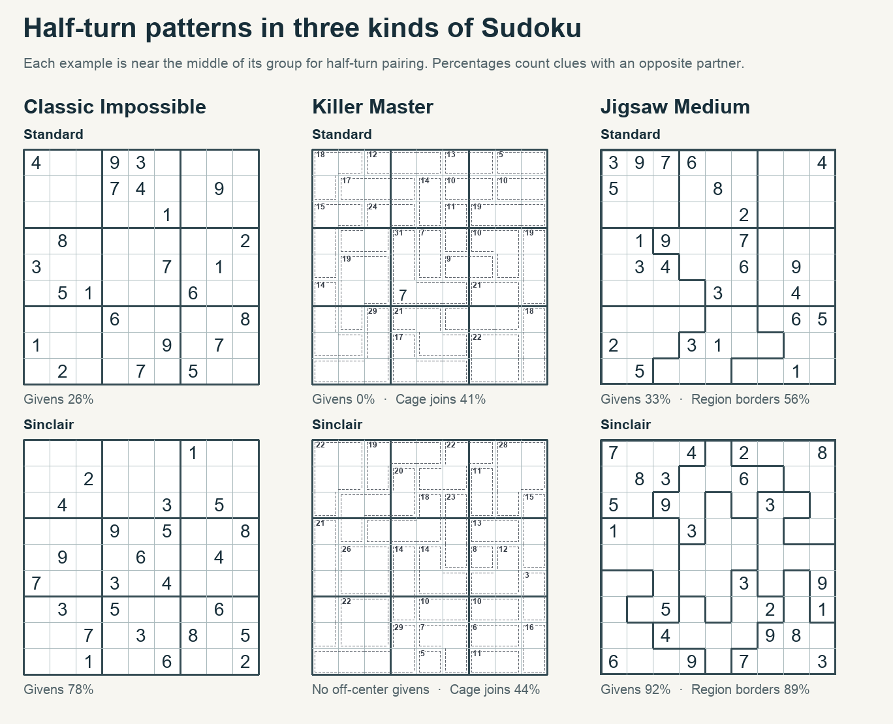

# The Sinclair puzzle library

The library contains 6,600 puzzles across nine variants, with 100 at each of the 66 selectable levels. Every puzzle has one solution. Every completed grid is different even after renaming digits or rearranging rows, columns and boxes. The 1,000 Classic puzzles also have 1,000 different starting clue patterns. [Independent solution checks](solutions.json) · [Pattern checks](variety.json)

In **New Puzzle**, choose a variant and difficulty, then select **Sinclair collection**. The first use downloads 100 puzzles at that level. Later visits can use the pack offline. In **Collections**, you can download a level or replay a puzzle by its title. Standard remains the default and generates puzzles on the device.

## What changed for the player

The strongest difference is visible before the first move. A half-turn matched 81.5% of Sinclair's clue layout on average, compared with 23.1% for Standard. Sinclair scored higher at every level. The number of logical steps barely changed. The median was 79 for Sinclair and 78 for Standard. A player's preference remains an open question. [Full results for all 66 levels](measurements.json) · [Try three pairs with their sources hidden](play.md)

To measure a half-turn, rotate the board 180 degrees. Count which starting clues land on other starting clues, ignoring their digits and the center cell. For variants, also compare cage joins, region borders, ordered lines or dots of the same color. Average the scores of the clue types present. Fixed box lines and diagonal guides earn no points. Of the selected puzzles, 525 had every measured clue paired. The Standard sample had none. [Measurement code](../../../../src/sudoku/sinclair-layout.ts)

| Variant | Levels | Sinclair puzzles | Different Standard answers | Standard half-turn match | Sinclair half-turn match |
| --- | ---: | ---: | ---: | ---: | ---: |
| Classic | 10 | 1,000 | 993 | 32.7% | 73.0% |
| Killer | 5 | 500 | 206 | 22.7% | 68.4% |
| Windoku | 10 | 1,000 | 394 | 24.4% | 88.8% |
| Diagonal (X) | 8 | 800 | 166 | 23.0% | 88.0% |
| Jigsaw | 3 | 300 | 128 | 46.3% | 86.2% |
| Anti-Knight | 8 | 800 | 174 | 25.6% | 91.1% |
| Thermometer | 8 | 800 | 31 | 12.1% | 87.7% |
| Arrow | 7 | 700 | 36 | 12.8% | 78.0% |
| Kropki | 7 | 700 | 200 | 18.2% | 68.9% |
| **All variants** | **66** | **6,600** | **2,322** | **23.1%** | **81.5%** |

The comparison used the November 18 research build and its Standard generator settings. The PR preserves the saved grids and checks their grades against the newer engine on main. The comparison used 100 independent first requests to Standard at each level. Each request used a fresh seed and an empty play history. Standard returned 6,599 puzzles. One Classic Extreme request reached its search limit. The total counts each underlying answer once, including answers shared across variants. A player with saved games can see a different sequence. [Standard sample and seeds](standard-sample.jsonl.gz) · [Sampling procedure](../../../../scripts/sinclair/catalog-controls.mts)

For Classic Impossible, Standard returned 98 different underlying answers from 100 requests. Sinclair supplied 100 different answers and 100 different starting clue patterns. Half-turn pairing rose from 28.0% to 79.7%. Median solve length rose from 110 to 113 steps. Both groups used three kinds of hardest deduction. In Sinclair, 42 puzzles peaked at nested forcing nets, 33 at quintuple pattern overlays and 25 at quadruple pattern overlays. [Puzzle-level scores and techniques](puzzle-measurements.csv.gz)

Killer Master showed a larger change in the logic. Standard produced two underlying answers and two kinds of hardest deduction. Sinclair produced 100 underlying answers and eight kinds of hardest deduction. All 500 Sinclair Killer puzzles start with empty cells. Connected cages cover the whole board, and their totals supply the clues. A single-cell cage gives its digit directly. The median puzzle has eight such cages, and ten puzzles have none. [Level results](measurements.json) · [Cage counts](variety.json)

The examples below are close to each group's middle score for half-turn pairing. In Classic, look for a starting clue across the center. In Killer, follow adjacent cells inside a cage. In Jigsaw, compare the bends in the region borders. To compare enjoyment, play the source-hidden pairs before viewing the grids. [Play the six puzzles](play.md)

## What the model learns

A completed grid tells us the answer. A solve path tells us what the player can discover along the way. The training study recorded 104,672 deductions from 602 puzzles. It kept rotations of each puzzle together when it split the data.

The study used 100 hand-set Nikoli puzzles, 435 credited Janko puzzles, seven competition Diagonal puzzles and 60 generated comparison puzzles. The competition and generated sets were reserved for testing. Solvers also supplied 339 verified player replays from the Janko archive. [Source breakdown and research data](../README.md#learning-from-a-solve)

The model predicts the next kind of deduction. A likely move costs fewer bits to describe. On 95 held-out puzzles, counting move types alone cost 2.156 bits per move. Adding the previous move, variant and solve phase cut that to 1.187. Learning how to combine six predictors cut it to 1.180. [Training results and sources](../README.md)

Sinclair compares each candidate with reference puzzles at a similar grade. It scores the order of deductions, the mix of techniques and patterns from player replays. A long run of singles can fit an Easy puzzle and fit a harder reference group poorly. The score also rewards visible clues that have a partner across the center.

The training data covers Classic, Killer and Diagonal Sudoku directly. The six other variants share a model based on those sources. The training split contained no Killer above Medium and no Diagonal above Tricky. The app can grade those puzzles. Only players can tell us which ones they enjoy. [Training coverage](../README.md) · [Blind comparison from the first edition](../comparison/blind-pairs.md)

The scoring model measures distance from a reference solve. A smaller number means a closer match. Sinclair reduced the median distance from 2.633 to 2.602 and improved it at 42 of the 66 levels. That small change matters when interpreting the much larger change in visual symmetry. The study measured layout and solver behavior. We have yet to collect player preference votes for this edition. [All level scores](measurements.json)

Radek Pelánek compared human solve data from more than 1,700 Sudoku puzzles. Both the difficulty of individual steps and the way steps depend on each other affected difficulty. Testing several ways through one puzzle would extend our current comparison of individual solve paths. [Difficulty Rating of Sudoku Puzzles](https://www.fi.muni.cz/~xpelanek/publications/sudoku-arxiv.pdf)

## How the puzzles differ

Two boards can look different and have the same underlying answer. For example, exchange every 1 and 9, then rotate the grid. Every original placement still has a corresponding placement on the new board.

The constructor gives each completed grid a standard form. It tries digit renaming, transposition, row swaps within bands, column swaps within stacks, and exchanges of whole bands or stacks. A band contains three neighboring rows. A stack contains three neighboring columns. It keeps one answer from each group across the entire library.

Classic gets a second comparison using only the positions of the starting clues. Two Classic puzzles with the same positions after any allowed rearrangement compete for one place in the library. For variants, Sinclair compares visible clue positions and shapes under the eight rotations and reflections of a square. It ignores the digits and cage totals during this comparison.

For Classic, the search tries arrangements that put more starting clues opposite each other. It grades each arrangement in the orientation the player sees. Some difficult Classic puzzles use positions from the credited forum collection. The upper levels can still share techniques or themes. [Forum collection and license](../../../../crates/engine/data/README.md)

For Killer, the search tries new cage outlines and changes the borders of promising cages. Another method swaps two digits across a group of cells that keeps every row, column and box valid. It redraws cage borders, calculates the totals and grades the resulting puzzle. For Jigsaw, the search varies the region borders. For Arrow and Thermometer, it builds lines around fresh solutions.

The first search tried 207,014 seeds and kept 135 graded candidates for each level. That gave 8,910 candidates before additional layout and cage searches. For Classic, the search graded up to three promising arrangements per candidate. For Killer, the release required a completely empty starting grid. The final pass chose 100 per level and excluded answers from the earlier 230-puzzle collection. Some puzzles share a construction method or a solving theme. [Construction and selection records](selection.jsonl.gz) · [Rebuild the library](../../../../scripts/sinclair/README.md#the-downloadable-library)

Three checks cover different kinds of mistakes. First, an independent solver found each published answer and ruled out a second answer. Removing the defining rule from each of the 5,600 variant puzzles allowed another solution. For Jigsaw, that check keeps rows and columns and removes the irregular regions. [Independent solver results](solutions.json)

Second, a separate program confirmed all 6,600 different answer patterns and all 1,000 different Classic starting patterns. Within each variant it also confirmed different visible layouts across all levels, even after rotation or reflection. Third, the exact engine in the production build reproduced every grade, point total, hardest technique and answer key. [Independent pattern checks](variety.json) · [Browser engine grades](grades.json) · [Production build checks](deploy.json)

When the app deals a puzzle, it skips previously dealt puzzles at that level. It also compares candidate answers with the answers in saved games. For recent puzzles it compares clue positions, visible shapes, the first six deductions and the hardest technique. Auto can favor a technique the player has needed help with. When the pack runs out, the player can change levels, use Standard, or replay a puzzle through Collections.

We simulated one complete deal of each pack and compared neighboring puzzles with a random shuffle of that same pack. Similarity ranges from zero to one. It weighs clue positions and shapes at 65%, the hardest technique at 20%, and the opening deductions at 15%. Average similarity fell from 0.225 to 0.153. It fell in all 66 packs. The last few puzzles offer fewer choices, and some neighbors can still feel alike. [Picker and comparison](../../../../scripts/sinclair/catalog-measurements.mts)

## How long a puzzle takes to open

The old live constructor sometimes spent roughly 25 seconds building and grading one Impossible puzzle. The new library does that work before release. A player pays for a download on the first visit to a level. The app then chooses among the checked puzzles it already has. This trades an unlimited search for a fixed collection of 100 at that level. [Earlier timing study](../live/REPORT.md) · [Impossible browser timings](browser-impossible.json)

On an Apple M3, desktop Chrome opened the first Classic Impossible puzzle in 48 ms on a local server. The next 99 had a median of 43 ms, and 90% opened within 46 ms. The test saw 100 different grids, one download and an exhaustion message on the next request. A fresh mobile-size browser view opened another Impossible puzzle offline in 55 ms. The timings start at the click and end when the saved board appears. Real phones and internet connections can differ. [100 consecutive starts](browser-impossible.json)

At Medium, the test started six puzzles per source in each of the nine variants. Both sources had a median of 42 ms. The 90th percentile was 45 ms for Sinclair and 73 ms for Standard. Nine first-time Sinclair downloads served all 54 starts. Standard made zero pack requests. A fresh mobile-size view opened a saved Jigsaw level offline in 72 ms. [108 starts across nine variants](browser-medium.json)

The Collections check opened a list of 100 Killer Hard puzzles without fetching their grids. Downloading the level made one request. After an offline reload, Chrome opened Killer Hard 001 from that pack. An unopened Jigsaw level explained how to download it. Standard Jigsaw still worked offline. [Offline collection test](browser-collections.json)

## How storage and downloads work

Netlify packages the 66 committed source files every time it builds the site. The constructor and full solver audits run separately. To generate a fresh edition, a maintainer can start the manual GitHub workflow and download its verified result for review. [Manual generation and build checks](../../../../scripts/sinclair/README.md#generate-a-new-edition-in-github-actions)

Each difficulty has one file. Its web address includes a hash of its contents. The app keeps the pack in browser storage when the browser permits it. A private session or a browser that clears stored data can need another download. An unopened difficulty needs an internet connection on its first visit.

| Data | Uncompressed | Gzip | Brotli |
| --- | ---: | ---: | ---: |
| All 66 puzzle packs | 4,076,543 bytes | 994,415 bytes | 967,342 bytes |
| Library index before bundling | 239,229 bytes | 97,670 bytes | 98,045 bytes |

The 66 files occupy 4.08 MB in the Netlify publish directory. A single difficulty averages 15.1 KB with gzip and ranges from 11.6 KB to 24.9 KB. Classic Beginner is the smallest, and Killer Easy is the largest. The app includes the index in its JavaScript. The offline installer fetches zero collection files. The shipped JavaScript contains none of the library's nonempty starting grids, completed grids or answer keys. Sizes use decimal units and local compression. [Measured sizes](measurements.json) · [Deploy check](deploy.json)

At 1,000 puzzles per level, this format would use about 40.8 MB for puzzles and 2.4 MB for the index. That estimate assumes similar puzzles and 100-puzzle downloads. Fetching every pack would transfer about 9.9 MB with gzip. The current build contains the 100-per-level edition.

Netlify's credit-based plans meter bandwidth and web requests. Netlify lists 20 credits per GB of outbound bandwidth and 2 credits per 10,000 requests. Its list of meters has no separate charge for static deploy storage. An account on a legacy plan uses its own billing terms. [Netlify credit meters](https://docs.netlify.com/manage/accounts-and-billing/billing/billing-for-credit-based-plans/how-credits-work/)

For example, 10,000 first-time pack downloads at the measured average would transfer about 150 MB with gzip. On those rates, the puzzle requests and bandwidth together would use about five credits. A production deploy is a separate 15-credit event. Actual delivery depends on the levels chosen, compression and other site traffic. [Netlify pricing calculation](https://docs.netlify.com/manage/accounts-and-billing/billing/billing-for-credit-based-plans/how-credits-work/)
