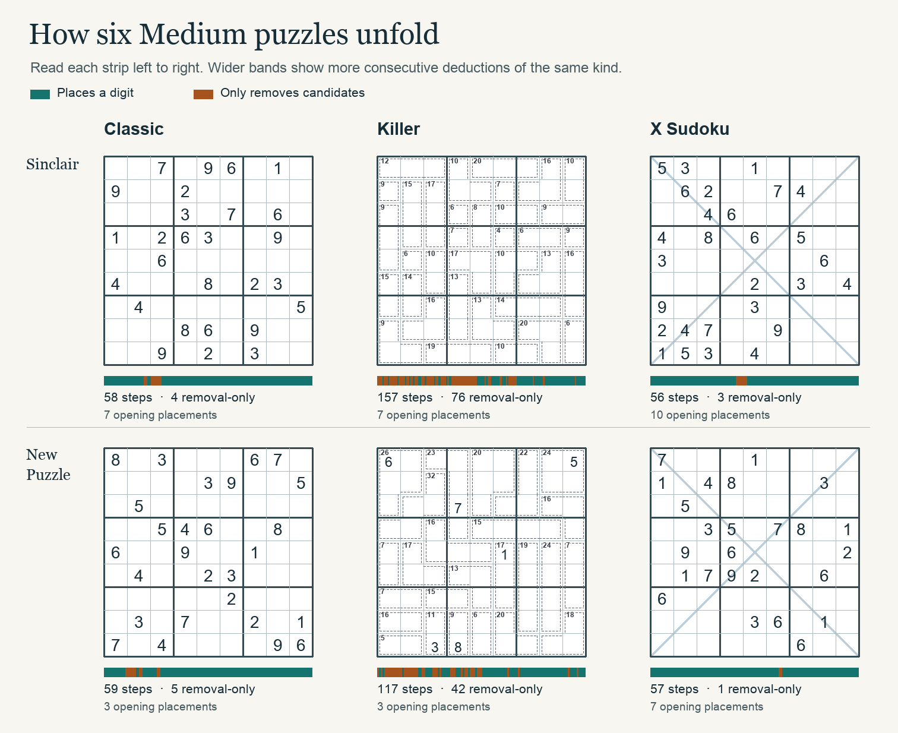

# Sinclair against New Puzzle

**All 230 Sinclair puzzles compared with 1,150 games from the app, matched across 23 variant and difficulty combinations.** Sinclair’s clearest advantage is variety in upper-level Killer and X Sudoku. In Classic, both generators produced different grids every time. The distinction there is pacing. Sinclair often gets you past the difficult part in fewer deductions. New Puzzle more often gives you a stretch of placements, a fresh obstacle and another opportunity for a breakthrough.

For visual beauty, the Classic boards look remarkably alike by one familiar constructor’s convention. Across **600 Classic boards**, neither group contained a single perfectly half-turn-symmetric clue pattern. For enjoyment, the most informative question is which rhythm you prefer. The playtest sheet currently has **zero enjoyment ratings**. You can try one source-hidden pair at any of the 23 levels before reading the explanations. [Play a matched pair](blind-pairs.md) · [Every Sinclair puzzle against its 50 controls](by-puzzle.csv)

## What changes as you solve

| Mean per puzzle | Sinclair Classic | New Classic | Sinclair Killer | New Killer | Sinclair X | New X |
| --- | ---: | ---: | ---: | ---: | ---: | ---: |
| Digits already printed in cells | 27.6 | 27.4 | 0 | 8.3 | 25.8 | 22.8 |
| Placements available on the first board | 6.2 | 6.3 | 8.3 | 7.3 | 7.7 | 5.4 |
| Steps that only remove candidates | 10.2 | 15.3 | 76.4 | 65.6 | 6.7 | 10.2 |
| Longest stretch of removal-only steps | 6.9 | 8.5 | 13.6 | 14.5 | 5.4 | 7.0 |
| Puzzles with 5 or more consecutive placements between two stretches of eliminations | 11% | 32% | 100% | 99% | 13% | 30% |

“Opening placements” counts distinct cells you can fill immediately without entering another digit first. For Killer, it allows all combinations within each individual cage. A removal-only step is one deduction, whether it eliminates one candidate or several. The five-placement measure counts moves in sequence and excludes both the opening run and the final cleanup. The worked example below checks which placement a particular deduction actually unlocked. Each difficulty contributes equally within its variant.

### Classic

**At Medium, I’d call it a draw.** Sinclair averaged 5.3 opening placements against 4.7, and both groups averaged 5.9 elimination steps. The two illustrated puzzles even have the same 27 givens and the same hardest technique, a naked pair. Both contain a deduction that leads directly to a placement.

The difference emerges at Very Hard and above. At Extreme, Sinclair averaged 14.1 elimination steps against 29.0, yet offered **fewer ways in**, 1.3 immediate placements against 4.3. Once the last elimination was finished, the Classic puzzles with any eliminations averaged 41 further placements for Sinclair and 36 for New Puzzle. I’d choose Sinclair for a tough deduction followed by a clear finish. For several changes of pace in one solve, I’d choose New Puzzle.

<details>
<summary>See one actual naked pair from each illustrated Classic puzzle</summary>

In **Sinclair C021**, R7C1 and R7C8 have only 2 and 8 as candidates. Those cells reserve both digits in row 7. Remove 8 from R7C3. Column 3 now has only one place for 8, so place 8 in R3C3.

In the **normal Medium puzzle**, R4C7 and R6C9 reserve 7 and 9 in the middle-right box. This removes 7 from R5C9 and both 7 and 9 from R6C7. Only 5 remains in R6C7. One pair resolves a column and the other resolves a cell in the same box. Both give the player a reason for the next digit.

</details>

### Killer

**I’d choose Sinclair for a run of hard Killers.** In 50 normal draws per level, Hard yielded **three** distinct puzzles, Very Hard **one**, and Master **two** after matching rotations and reflections. Each Sinclair level has **ten**. All five ten-game Very Hard libraries returned the same underlying puzzle. Its rotations still changed the order in which the solver found moves.

Sinclair also feels different at the *easy* end. The normal Easy Killer offered 30.5 possible placements after checking the cages, with 24 digits already printed. Sinclair Easy started with an empty grid, averaged 11.9 one-cell cages, and offered 12.0 immediate placements. The typical path involved 58.6 removal-only deductions against 8.9. Someone looking for a quick, welcoming puzzle has a good reason to choose normal Easy. Someone who enjoys working cage combinations from the beginning has a good reason to choose Sinclair.

Across all five levels, the average number of digits specified outright was almost identical, **8.26 for Sinclair and 8.27 for New Puzzle**, counting one-cell cage totals as fixed digits. The presentation and the timing of the arithmetic differ. Sinclair averaged 69.1 steps using cage combinations or a house sum against 55.2. Of those, deductions explicitly using a house total of 45 averaged 4.3 against 7.5. More cage work can mean more bookkeeping as well as more discoveries.

### X Sudoku

**Sinclair offers the easier entry. New Puzzle makes the diagonals more explicit.** Sinclair averaged 7.7 opening placements against 5.4 and three more givens per board. Its paths averaged 2.8 deductions explicitly citing a diagonal against 4.1. Other deductions can depend indirectly on candidates already removed by a diagonal. Every one of the 480 X puzzles needed the extra rules for uniqueness.

There is a real choice for someone who likes diagonal logic. At Very Hard, Sinclair averaged 8.2 immediate placements and 6.4 elimination steps. New Puzzle averaged 4.0 and 12.6. For a sequence of different puzzles, normal Master and Extreme each yielded five distinct puzzles in 50 draws. Each corresponding Sinclair set has ten.

## What looks different



The top row shows C021, K011 and X011, the first published Medium puzzle in each family. The bottom row shows the first Medium draw in the first normal library. Each strip spans one solve. The width of a band shows the fraction of that solve spent on consecutive steps of the same kind. These examples illustrate the comparisons above. The conclusions use all the puzzles.

- **Classic.** Excluding the center cell, 34.2% of Sinclair givens had a partner across the center against 33.2% for New Puzzle. Once clue count is accounted for, those figures are only 1.0 and 0.3 percentage points above random placement. For perspective, all 100 Classic puzzles in the handmade Nikoli reference set have perfect half-turn symmetry. Neither generator reproduced that particular design convention in this sample. [Nikoli dataset](https://huggingface.co/datasets/SakanaAI/sudoku-bench-nikoli)
- **Killer.** Sinclair has more cages per board, 32.7 against 25.0. It uses fewer distinct cage shapes per board, 7.8 against 8.6, treating rotated or reflected shapes as the same shape. Finer divisions and more one-cell sums make Sinclair visually recognizable. Neither set had an exactly half-turn-symmetric combination of cages and given positions.
- **X.** Givens had a partner across the center 33.4% of the time for Sinclair and 23.9% for New Puzzle. Allowing for the extra Sinclair givens reduces the gap to 5.7 percentage points above the difference expected from density alone. Neither set contained a perfectly half-turn-symmetric clue pattern.

**The completed answers also repeat in different ways.** Every puzzle had exactly one solution. Counting answer grids across the eight orientations of the square, with digit renaming for Classic and X, the Sinclair sets had 100 Classic, 50 Killer and 80 X answers. The normal sets had 500, 106 and 104. No answer was shared across the two sources within a variant under that comparison. The answer-grid check uses a narrower rule than the Classic starting-puzzle duplicate check, which also permits legal row and column permutations.

## All 23 matched levels

Each paired value gives **Sinclair / New Puzzle**. The first numeric column counts different normal puzzles among 50 returned. All Sinclair groups had ten different puzzles in ten. Lower reference distance means the engine paths more closely resembled the archive paths on the model’s chosen measurements. At normal Master Killer, the unrounded opening mean was 0.04.

| Level | Different normal puzzles / 50 | Opening placements | Removal-only steps | Reference distance |
| --- | ---: | ---: | ---: | ---: |
| Classic · Beginner | 50 | 14.7 / 14.3 | 0.0 / 0.0 | 0.15 / 0.26 |
| Classic · Easy | 50 | 10.1 / 9.8 | 0.0 / 0.0 | 0.18 / 0.33 |
| Classic · Medium | 50 | 5.3 / 4.7 | 5.9 / 5.9 | 0.28 / 0.53 |
| Classic · Tricky | 50 | 8.1 / 6.6 | 6.5 / 6.9 | 0.50 / 0.79 |
| Classic · Hard | 50 | 7.3 / 7.2 | 6.7 / 7.3 | 0.93 / 1.58 |
| Classic · Very Hard | 50 | 7.7 / 5.7 | 5.4 / 11.1 | 1.09 / 1.86 |
| Classic · Expert | 50 | 4.8 / 5.2 | 10.2 / 15.0 | 1.42 / 2.27 |
| Classic · Master | 50 | 2.2 / 4.8 | 12.0 / 23.5 | 1.32 / 2.51 |
| Classic · Extreme | 50 | 1.3 / 4.3 | 14.1 / 29.0 | 2.11 / 2.93 |
| Classic · Impossible | 50 | 0.3 / 0.0 | 40.7 / 54.1 | 3.01 / 3.08 |
| Killer · Easy | 50 | 12.0 / 30.5 | 58.6 / 8.9 | 0.19 / 0.79 |
| Killer · Medium | 50 | 5.2 / 3.7 | 77.0 / 47.2 | 0.12 / 0.42 |
| Killer · Hard | 3 | 10.8 / 1.0 | 71.9 / 85.4 | 0.69 / 0.77 |
| Killer · Very Hard | 1 | 8.9 / 1.0 | 81.4 / 81.4 | 0.88 / 0.80 |
| Killer · Master | 2 | 4.6 / 0.0 | 93.1 / 105.3 | 0.91 / 1.65 |
| X · Easy | 45 | 11.2 / 10.4 | 0.0 / 0.0 | 0.14 / 0.46 |
| X · Medium | 21 | 8.0 / 7.1 | 2.7 / 2.2 | 0.33 / 0.58 |
| X · Tricky | 5 | 9.6 / 6.1 | 2.6 / 6.2 | 0.82 / 1.75 |
| X · Hard | 12 | 7.6 / 5.4 | 4.5 / 11.4 | 1.15 / 2.42 |
| X · Very Hard | 7 | 8.2 / 4.0 | 6.4 / 12.6 | 1.42 / 2.55 |
| X · Expert | 7 | 5.4 / 3.6 | 9.5 / 12.2 | 2.04 / 2.62 |
| X · Master | 5 | 5.4 / 5.1 | 10.4 / 14.5 | 2.15 / 2.92 |
| X · Extreme | 5 | 5.8 / 1.6 | 17.8 / 22.2 | 3.01 / 3.09 |

## What the comparison establishes

**The model can steer the solve.** Sinclair was closer to the reference style at 22 of 23 levels. The same 22 led against each of the five normal libraries and when each distinct normal puzzle received equal weight within its level. The exception was Very Hard Killer, where the one repeated normal puzzle scored 0.80 against Sinclair’s 0.88. This is a stricter comparison than the construction study’s random draws from Sinclair’s own eligible candidates. The selector deliberately optimized this measure across code length, technique distribution and predicted replay behavior. The training split contained no Killer above Medium or X above Tricky. A preference claim at those levels would need player evidence. [Construction study and training coverage](../README.md)

**The pacing differences survive a change in move order.** I rotated every puzzle 180° and solved it again, changing which available move the engine encounters first. All 1,380 kept their app grade. In that orientation the mean elimination counts were 10.8 against 15.2 in Classic, 77.1 against 66.2 in Killer, and 6.7 against 10.2 in X. Giving every distinct normal puzzle equal weight within its level put the normal means at 15.3, 61.4 and 9.9 in the original orientation. A human can choose other paths, combine several small eliminations mentally or stop after spotting a different deduction.

**What I would change in the generator.** For upper Killer and X, track previously returned rule layouts under rotation and reflection. Very Hard Killer also needs more certified puzzles to draw from. For Classic, I would test a selection rule that rewards a useful run of placements after a difficult deduction *before* the final cleanup. The current selector reduced precisely that pattern across the Classic collection. For visual design, I would test paired clue removal on Classic, then rerate and compare equally difficult puzzles with the symmetry choice hidden. The source-hidden pairs let us collect separate votes for appearance and enjoyment. [Playable pairs and answer key](blind-pairs.md)

## Method and reproduction

On 17 November 2026 I sampled the app’s real, fixed-difficulty **New Puzzle** path. Each of the 23 groups got five independently seeded libraries. Each library started empty and requested ten consecutive games at one difficulty, providing its existing games to the generator on every request. One Classic Extreme request reached the search limit. The next seeded request produced the next game. The analysis includes every successfully returned game, including repeats. The balanced design gives each selectable level equal weight regardless of how often players usually choose it. Jigsaw is outside this edition.

For Classic, starting-grid identity allows digit renaming, transposition and legal row, column, band and stack permutations. For variants it allows rotations and reflections, preserves numeric cage sums, and permits digit renaming for X. Normal variant generation can fall back to stored seeds and reflect a puzzle if it matches saved givens. That fallback supplied 151 of 250 Killer draws and 328 of 400 X draws. An independent backtracking implementation verified the answer of every game. The saved measurements include both scan orders and the hash of the completed answer. The CSV pairs each Sinclair puzzle with its own level’s 50 returned games. [Normal Classic generation](../../../../src/sudoku/classic-generation.ts) · [Normal variant generation](../../../../src/sudoku/variant-play.ts) · [Frozen normal draws](normal-draws.json.gz) · [Per-game measurements](measurements.json.gz) · [Level and library summaries](results.json)

The merged app at `70fab58`, with the local collection changes, reproduced the same 1,150 game definitions, point totals and request failure as the pre-merge app. The exact browser engine digest is recorded in the level summaries. In the raw draws, `sourceSeed` records the seed returned by the variant API. For Classic this field repeats the request seed because that API does not expose the source it chose. To regenerate the study, use Node with TypeScript stripping, Rust with the WebAssembly target, and Python with NumPy and Pillow. The commands run from the repository root.

```sh
npm run build:wasm
cargo build --release -p sudoku-app-engine --features wasm-api --example sinclair
node --experimental-strip-types scripts/sinclair/comparison/sample-normal.mts /tmp/sinclair-normal classic
node --experimental-strip-types scripts/sinclair/comparison/sample-normal.mts /tmp/sinclair-normal killer
node --experimental-strip-types scripts/sinclair/comparison/sample-normal.mts /tmp/sinclair-normal x
python3 scripts/sinclair/comparison/compare.py /tmp/sinclair-normal
python3 scripts/sinclair/comparison/examples.py
node --experimental-strip-types scripts/sinclair/comparison/verify.mts
```

To repeat the analysis without drawing new games, pass `docs/research/sinclair/comparison/normal-draws.json.gz` to `compare.py`. Its `--output` option writes the measurements to a separate directory.
