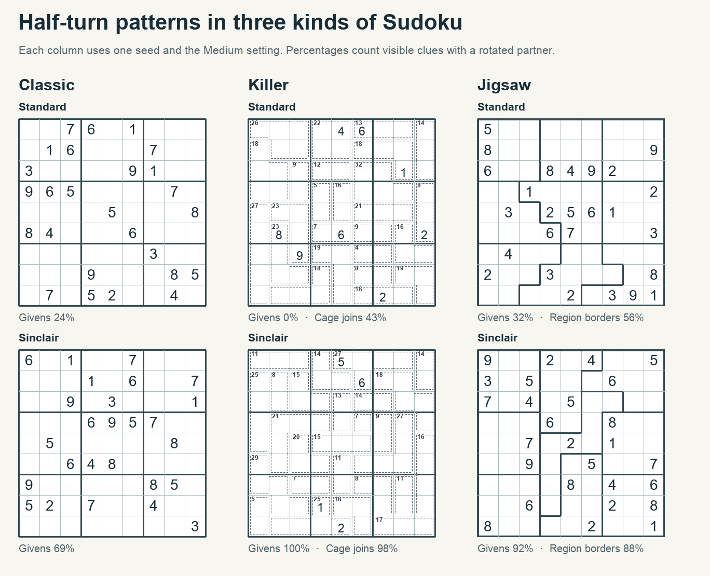

# The earlier live Sinclair generator

This study measured the live constructor and its embedded Impossible bank. The downloadable edition now supplies the Sinclair option in New Puzzle. The timing and reuse measurements below refer to the earlier builds. [Current library and measurements](../catalog/REPORT.md)

**Impossible Classic appeared in 40 milliseconds at the median** on an Apple M3. The 90th percentile was 45 ms across 96 starts in desktop Chrome. The original constructor spent a median of 25.4 seconds in the engine alone. At Medium, the earlier nine-family comparison measured a 94 ms click for Sinclair and 44 ms for Standard, with half-turn pairing improving from 24.4% to 72.1%. [Impossible browser timings](impossible-browser.json) · [Medium browser timings](browser.json) · [Original seeded study](summary.json)



The figure uses the same seed for both constructors in each column. For each family it shows the pair closest to the two generators’ median pairing scores. In the Classic example, rearranging rows and columns puts more givens opposite each other. In Killer, look for the outline of a cage on the other side of the center. In Jigsaw, follow the bends in the thick region borders. For a solve comparison, the nine source-hidden pairs use separate seeds and separate completed grids. [Play the comparison puzzles](play.md)

## How long a player waits

In the production browser test, **the 90th-percentile wait for a Medium Sinclair puzzle was 179 ms**, against 95 ms for Standard. I measured from the click on Start until the new game was saved and its grid appeared. Each family got six starts per generator in one growing library. The app chose its own random seeds. A separate check reopened a saved Sinclair preference on the mobile layout, switched the browser offline and generated a Medium Jigsaw in 228 ms. All browser measurements used desktop Chrome 157 on the same Mac. Phone hardware and a first download over a remote connection still need their own measurements. [Browser measurements](browser.json) · [Browser procedure](../../../../scripts/sinclair/browser-live.mjs)

| Medium puzzle | Standard click | Sinclair click | Standard pairing | Sinclair pairing |
| --- | ---: | ---: | ---: | ---: |
| Classic | 57 ms | 116 ms | 31.0% | 68.5% |
| Killer | 49 ms | 122 ms | 24.7% | 96.4% |
| Windoku | 42 ms | 60 ms | 28.2% | 94.4% |
| Diagonal (X) | 44 ms | 67 ms | 27.2% | 67.5% |
| Jigsaw | 44 ms | 63 ms | 44.0% | 84.3% |
| Anti-Knight | 83 ms | 167 ms | 29.8% | 72.6% |
| Thermometer | 43 ms | 77 ms | 9.8% | 52.3% |
| Arrow | 63 ms | 209 ms | 13.9% | 44.8% |
| Kropki | 43 ms | 93 ms | 11.0% | 68.2% |

The two time columns are browser medians. The pairing columns come from a larger, same-seed engine comparison with 12 pairs per family. Arrow still has room to improve. Its Medium givens had opposite partners 72.9% of the time, but only 16.6% of complete arrows matched another arrow from circle to tip. Medium Killer reached 98.7% for cage joins. Jigsaw reached 82.7% for region borders. [Per-family results](summary.json)

**Difficulty changes the timing.** In the original balanced sample of four seeds at each of the 66 selectable variant and difficulty combinations, Sinclair used a median of 121 ms of engine time and a 90th percentile of 1.10 s. Standard used 56 ms and 0.62 s. At Classic Extreme the respective medians were 1.76 s and 0.89 s. At Classic Impossible they were 25.4 s and 5.83 s, with a slowest Sinclair call of 33.25 s. Windoku Impossible had a Sinclair median of 4.66 s. Four calls per level describe this run and leave substantial uncertainty about the longest wait on another device. The app runs the solver in Web Workers. [Original per-level timings and search routes](summary.json)

The app imports the live constructor when Sinclair is selected. The shared selection code and trained weights use **15.76 kB gzipped** in the new production build. Impossible Classic loads a separate **73.44 kB gzipped** chunk containing the certified continuations and their constructor. Training happens offline. The app’s installed offline cache includes both chunks and the WebAssembly engine. [Runtime model](../../../../src/sudoku/sinclair-score.ts) · [Offline shell](../../../../scripts/build-offline.mjs)

## How Impossible Classic starts faster

The old generator searched for a puzzle when you pressed Start. It solved the puzzle, moved the starting digits to improve symmetry, and solved the new layout again. On one run, finding the puzzle used 2.54 seconds and recording its moves used 2.29 seconds. Grading the second layout used 1.94 seconds, and recording its moves used another 1.83 seconds. Finding the more symmetric layout used only 6 milliseconds. [Timing for each step](impossible-profile.jsonl)

We now solve 256 hard positions before release. Each position is a partly filled grid with known moves to finish it. When you press Start, Sinclair can hide some of the starting digits. It uses that opening only if simple moves force every missing digit back into its original cell. The board then matches the saved position exactly. Sinclair can use the hard moves it already knows to rate the puzzle. [How the app selects a puzzle](../../../../src/sudoku/sinclair-impossible.ts)

### How different are the puzzles?

Sinclair recognizes a saved puzzle if you swap digit names, rotate the grid, or rearrange rows and columns in ways that preserve the rules. Even after grouping such copies, the fast generator offers 906 different starting grids. An independent solver found exactly one answer for each. Counting the digits in their actual cells, those 906 starts lead to 256 different completed grids. [Starting grids and their optional digits](../../../../src/sudoku/sinclair-impossible-cores.json) · [How the app recognizes copies](../../../../crates/engine/src/generation/canonical.rs)

Of the 256 hard positions, 174 have one starting grid each. The other 82 account for 650 extra openings. Each extra opening hides one to six digits. Once you place those digits, you face the same hard choices as someone who started with them printed. [Puzzle bank](../../../../src/sudoku/sinclair-impossible-cores.json)

Sinclair gives priority to hard positions you have yet to play. In one test, we kept all 320 puzzles saved. The first 256 had different completed grids. Each of the next 64 had new starting clues and a completed grid we had already seen. Across all 320 starts, Sinclair used a stored grid 186 times and changed the opening 134 times. Removing a game from your library can make its puzzle eligible again. [All 320 starts](impossible-engine-draws.jsonl.gz) · [Counts by type of opening](impossible-engine.json)

### One opening you can try

Paste the grid below into Import. Row 9 contains 2, 4, 6, 8 and 9. Column 7 contains 1, 3 and 7. Only 5 can go in row 9, column 7.

```text
600000700001050300040200080000000100050040020003002000080005290000890007906420008
```

One version prints that 5 for you. The other leaves the cell blank. After you place the 5, the solver makes exactly the same 90 moves in both versions. Both earn the Impossible rating. The blank cell adds one move, so the score rises from 17,972 to 17,976.

### What Sinclair still tests

Before release, we start with the existing Impossible puzzles and try new arrangements with more starting digits opposite each other. We also try adding one digit from the answer. We keep a position only if the solver rates it Impossible and finds the required hard moves. The solver also tries three orders of easier techniques. We discard any position those techniques can finish. [Original puzzles and credits](../../../../crates/engine/data/README.md) · [How we prepare the positions](../../../../scripts/sinclair/build-impossible.mts)

At play time, the app makes sure that each puzzle it returns has exactly one answer. For a changed opening, it also tries the easy moves in two orders. Both must reach the exact saved position. In 40 puzzles, a fresh solve reproduced every technique count, the hardest move, the difficulty and both scores. All 40 passed the usual Impossible test. A second build reproduced the saved positions and moves byte for byte. [Results for the 40 puzzles](impossible-engine.json) · [Rebuild instructions](../../../../scripts/sinclair/README.md#impossible-classic-in-new-puzzle)

Sinclair uses four numbers per move to score how a puzzle plays. They record the technique, how many digits it places, how many possibilities it rules out and the first cell it affects. Together they use four bytes. One old puzzle used 310 kB to record its full solve. The app can still produce a detailed solve when a player asks for analysis. [How Sinclair stores moves](../../../../scripts/sinclair/build-impossible.mts) · [How Sinclair scores them](../../../../src/sudoku/sinclair-score.ts)

If your saved games cover every eligible start, Sinclair uses the slower search. It also uses that search if the solver changes or if Auto requests a technique outside the saved set. That search can still use seconds. The fast set covers three Impossible techniques under Auto. Their names in the app are nested forcing net, quadruple pattern overlay and quintuple pattern overlay. [How the app chooses a search](../../../../src/sudoku/sinclair-generation.ts)

### What the timing tests measured

We compared the generators on the same four random seeds. A seed tells a generator where to start its search. The middle generation time fell from 25.4 seconds to 11.4 milliseconds. We used the same Mac at different times, and the load on the Mac varied. [Times for the four seeds](impossible-engine.json)

In 96 starts in desktop Chrome on an Apple M3, half the puzzles appeared within 40 milliseconds. Ninety percent appeared within 45 milliseconds. The first start was also the slowest at 109 milliseconds. We measured from the click until all 81 cells showed the new puzzle. An installed copy on the same Mac opened an offline puzzle in 123 milliseconds using the mobile layout. We measured a local copy of the app on desktop hardware. [All 96 starts and the offline result](impossible-browser.json)

In 320 consecutive starts with saved history, half the generation times fell under 16.7 milliseconds. The 90th percentile was 31.0 milliseconds and the longest time was 57.5 milliseconds. On average, 77.7 percent of starting digits had another starting digit opposite them across the center. On the four matched seeds, that share was 84.0 percent for the fast generator, 74.8 percent for the earlier Sinclair generator and 25.6 percent for Standard. Measuring enjoyment needs player feedback. [Generation times and symmetry](impossible-engine.json) · [Original matched puzzles](draws.jsonl.gz)

## How long the original 230-puzzle edition needs

I rebuilt the released collection twice on the same Apple M3. Starting from the frozen research corpus and an empty candidate directory, the three-job run finished in **28 minutes 48 seconds**. It trained the models, searched 27,673 proposals, ran four rounds of model-guided edits, selected the finalists and verified the release. That is **7.51 seconds per published puzzle when averaged over the batch**. Repeating the build with the seeded candidate streams already cached and verified finished in **55.27 seconds for all 230**. Both runs reproduced the three released collection files byte for byte. Opening one of those published puzzles in Collections only loads its saved definition. [Timed runs and release hashes](editorial-timing.json) · [Edition reproduction commands](../../../../scripts/sinclair/README.md)

## What the constructor learns

The original Sinclair model learned the order of deductions from 352 training puzzles. It combines six estimates of the next deduction family, including what just happened and how much of the grid is filled. It also estimates the pattern of pencil-mark use seen in player replays. A candidate earns a better score when its solve resembles the reference paths for that grade. A run of easy placements can be appropriate for one grade and unusual for another. [Training and held-out results](../README.md)

The live generator uses those learned quantities and a separate preference for clue geometry. One tenth more of the clue layout paired across the center is worth 0.4 units of solve-path distance. This is an explicit design choice. The current edition has no human preference labels for fitting that trade-off. Candidates must first pass the app’s checks for a unique answer and the selected difficulty. A variant puzzle also needs the named rule to distinguish its answer from another completion. [On-device selection](../../../../src/sudoku/sinclair-generation.ts) · [Variant acceptance checks](../../../../crates/engine/src/variant/generation.rs)

Three families have their own reference profiles in training. They are Classic, Killer and Diagonal (X). The other six use the pooled reference profile. The engine still solves and grades each under its actual rules. Performance in Jigsaw, Windoku, Anti-Knight, Thermometer, Arrow and Kropki therefore tests how well the learned solve pattern transfers. Additional hand-set puzzles and player replays in these families would let us fit and evaluate their own profiles. [Model export](../../../../scripts/sinclair/export_runtime.py) · [On-device scoring](../../../../src/sudoku/sinclair-score.ts)

## What a half-turn pairs

Rotate the grid 180°. R2C3 lands on R8C7. If both cells show givens, their positions form a pair. A 2 opposite an 8 counts in exactly the same way as a 2 opposite a 2. This gives the constructor freedom to use the digits that make the logical solve work. The center cell maps to itself, so we leave it out of the percentage.

| Visible clue | What must line up after rotation |
| --- | --- |
| Givens | Another given at the opposite position |
| Killer cages | A shared cell edge inside a cage lands on another such edge. This measures cage shape and leaves the arithmetic totals free. |
| Jigsaw regions | An internal grid edge separating two regions lands on another region border. |
| Thermometers and arrows | The entire path lines up, bulb to bulb or circle to circle, with the same direction along the path. |
| Kropki dots | A dot of the same color lies across the rotated cell edge. |

For each puzzle, we average the fractions for the nonempty layers. A Killer puzzle with no givens is scored on cage joins alone. The standard box lines, outside frame, Windoku shading and printed X diagonals supply no points. For givens we also calculate how much pairing exceeds chance at the same density. With `n` occupied cells outside the center, a uniformly placed given has probability `(n − 1) / 79` of having an opposite partner. [Geometry and scoring](../../../../src/sudoku/sinclair-layout.ts)

The first Sinclair edition gives a reason to measure geometry explicitly. None of the 100 original Sinclair classics or the 500 matched classics from New Puzzle had perfect half-turn symmetry. All 100 hand-set Nikoli reference grids did. A model trained only on sequences of deductions has no direct observation of that visual choice. [Earlier comparison](../comparison/REPORT.md) · [Research measurements](../../sudoku-construction/REPORT.md) · [Nikoli dataset and credits](https://huggingface.co/datasets/SakanaAI/sudoku-bench-nikoli)

## How the puzzles are made

**Classic.** Start with a puzzle that passes the standard generator and its history and technique-focus checks. Search 2,916 legal row and column arrangements for clue patterns with more opposite partners. Re-grade the strongest arrangements in their displayed orientation because a solver can find a different deduction first. At Beginner through Tricky, also try carving fresh clue patterns from the completed grid in mostly opposite pairs. At Master and above, test a single alternate arrangement to limit the cost of proving the grade. A rearranged classic is the same underlying Sudoku with a new presentation. A fresh carving can change which deductions are needed. [Classic implementation](../../../../src/sudoku/sinclair-generation.ts)

**Variants.** Start with three seeded attempts. Remove givens mostly in opposite pairs. For Killer, merge connected cages in pairs, then try splitting a leaf cell off one side. For Jigsaw, exchange opposite boundary cells while preserving nine connected cells in each region, then try an unmatched exchange. For arrows, thermometers and dots, put a matching clue on the other side only when the solution satisfies the corresponding sum, order or dot relation. When a fresh layout misses the grade, edit the givens of a calibrated puzzle and certify each edited result. A calibrated puzzle can itself be returned when edits miss. Saved equivalent puzzles are excluded from selection. [Layout proposals](../../../../src/sudoku/sinclair-layout.ts) · [Exact carving and uniqueness](../../../../crates/engine/src/variant/generation.rs)

**Why live and editorial puzzles differ.** The editorial process can compare many independent construction lineages and two complete solve paths for the finalists. New Puzzle scores one complete path per eligible candidate and makes a bounded number of proposals while the player waits. The same trained sequence and replay model runs locally. Four reference scores, including the pooled transfer case, reproduce the Python model within one billionth. [Parity and generation tests](../../../../scripts/sinclair/live-generator.test.mts)

## How the solutions compare

Across the balanced 264 pairs, Sinclair produced a higher visual pairing score in **239**, tied in **23** and scored lower in **2**. The mean rose from 22.1% to 55.7% across those levels. At Medium it improved in 106 of 108 pairs, with two ties. Density alone explains little of the difference. At Medium the Sinclair givens exceeded the random expectation for their count by 52.4 percentage points on average. Standard givens were 0.8 points below that expectation. [Matched results](summary.json)

Using the same seed, the two generators produced **the same 81 solution digits in the same cells in 180 of 336 pairs**. Editing givens on a shared completed grid can still change which deduction unlocks the puzzle. In the other 156 pairs, at least one displayed solution digit differed. All 12 Medium Sinclair classics came from legal rearrangements of the standard generator’s puzzle for that seed. A player can see a different opening because cells move to different places in the scan order. [Independent solution hashes](independent-check.json)

Other variants can change the constraints themselves. In the balanced Sinclair sample, 83 results came from fresh paired carving, 122 from editing givens, 33 from rearranging a classic and 26 directly from a calibrated recipe. Across all 336 requests per generator, Sinclair produced 327 different written definitions and Standard produced 260. Related puzzles can have different written definitions. [Per-puzzle records](draws.jsonl.gz)

At Medium the mean solve-path distance to the training examples was **1.793 for Sinclair and 1.795 for Standard**. Lower is closer. Sinclair’s distance improved for Windoku and increased for Diagonal. The engine recorded 79.5 deductions per Sinclair puzzle versus 77.3 for Standard. The large measurable effect here is in clue geometry. A judgment about enjoyment needs players’ choices. The playtest asks for a first-impression preference before a move, then which puzzle the player would play again after completing both. A solver may recognize a visually systematic layout, so hiding the generator name gives only partial blinding. [Solve-path summaries](summary.json) · [Play the nine pairs](play.md)

## Coverage and checks

The test called both generators for all **66** choices. These comprise 10 Classic, five Killer, 10 Windoku, eight Diagonal, three Jigsaw, eight Anti-Knight, eight Thermometer, seven Arrow and seven Kropki levels. The matched study made 336 calls per generator, including the additional Medium draws. Every call returned its requested grade. I replayed the logical solve and checked the completed digits against the printed rules. An independent Boolean encoding in Z3 then proved exactly one answer for every one of the 563 distinct definitions across the 672 returned puzzles. On all 467 distinct variant definitions, dropping the named rule admitted another answer. For Jigsaw, this check drops irregular region houses and keeps rows and columns. [Completion certificates](independent-check.json) · [Independent checker](../../../../scripts/sinclair/audit-live.py)

Odd/Even, Anti-King and Quadruple are examples of families that the app can import outside the New Puzzle generator. Extending Sinclair to those families needs generation recipes, difficulty calibration and a rule-dependency check. Odd/Even gives a concrete next design. A constructor could place a circle opposite a circle when both solution digits are odd, or a square opposite a square when both are even, and leave a few marks unmatched. Hand-set references would also let us learn whether players use those marks early or late. [Current family definitions](../../../../src/sudoku/variants.ts)

## Reproduce the measurements

The matched study uses the normal fixed-difficulty app entry points and the browser’s Wasm binary under Node 26 on macOS arm64. It warms both code paths first, starts each seeded request with empty history, alternates which generator runs first and records the complete generation call. Additional verification runs after the timer stops. The browser study retains game history. Timings reflect the local machine and other work running during the study. [Raw generation records](draws.jsonl.gz) · [Summaries and binary fingerprint](summary.json) · [Browser records](browser.json)

Run these commands from the repository root with the Rust WebAssembly target, Node, Python, NumPy, Pillow and the Z3 command-line tool installed. Use a new path for the raw JSONL output. The general benchmark exercises the current constructor, so new Classic Impossible results reflect the faster route. The summary command draws the figure, checks the puzzles independently and writes the playable pairs.

```sh
npm run build:wasm
python3 scripts/sinclair/export_runtime.py --output /tmp/sinclair-weights.json
cmp src/sudoku/sinclair-weights.json /tmp/sinclair-weights.json
node --experimental-strip-types scripts/sinclair/benchmark-live.mts /tmp/sinclair-live.jsonl 4 12
python3 scripts/sinclair/summarize-live.py /tmp/sinclair-live.jsonl /tmp/sinclair-report
node --experimental-strip-types scripts/sinclair/benchmark-impossible.mts /tmp/impossible-engine.json 320 40
```

For the click timings, serve the production files, then run the browser study with Playwright and Chrome installed. Set `CHROMIUM_PATH` to use a system Chrome executable and `PLAYWRIGHT_MODULE` if Playwright is installed outside the project. The browser uses disposable profiles. Its local offline check maps a reserved test hostname to the loopback server so it exercises the app’s normal production service worker. The app intentionally clears service workers on localhost.

```sh
npm run build
python3 -m http.server 4379 --bind 127.0.0.1 --directory dist/client
# In a second terminal
node scripts/sinclair/browser-live.mjs http://127.0.0.1:4379 /tmp/sinclair-browser.json 6
node scripts/sinclair/browser-live.mjs http://127.0.0.1:4379 /tmp/impossible-browser.json 96 impossible
```
