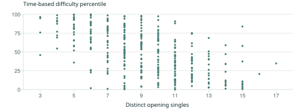
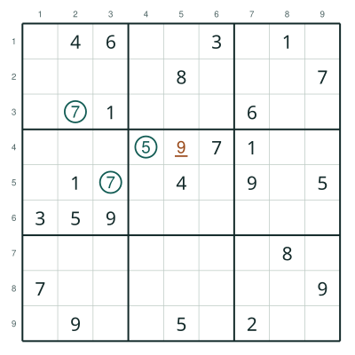
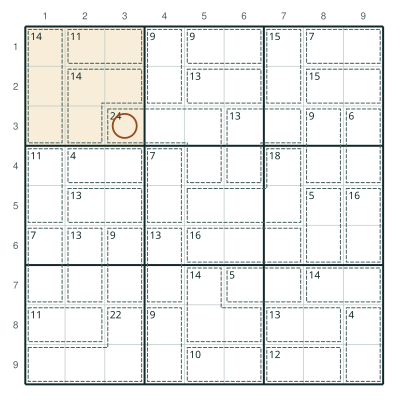
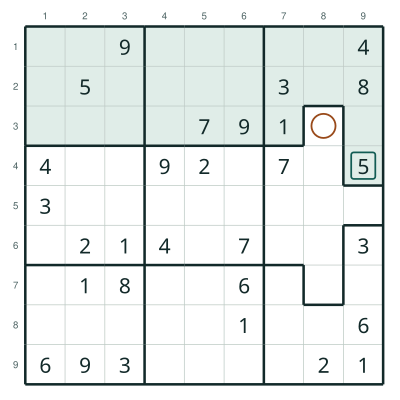

# Learning to construct Sudoku puzzles

**Research report · 17 November 2026**

We can learn a measurable part of a setter’s craft from finished puzzles. I trained a small model on the openings of 100 hand-set Nikoli classics and used it to choose among puzzles from this app. At the same difficulty, the selected puzzles came closer to the number of first moves that Nikoli offered. The resemblance largely faded by the third round. In a separate dataset of 344 puzzles played by people, opening width tracked human difficulty even within the same clue count and app tier. Whether players prefer the resulting puzzles is the next question. [Cloud Sudoku data](https://github.com/synnwang/sudoku_dataset_difficulty)

| Experiment | Result | Design decision |
| --- | --- | --- |
| Predict the next round of singles | Knowing the opening saved 0.071 bits per eligible Nikoli puzzle. The uncertainty interval included zero. | Keep a simple predictive baseline. |
| Choose among four valid classics | The first-round gap fell from 4.57 to 3.07 placements. The third-round gap went from 1.27 to 1.21. | Learn targets for several points in a solve. |
| Move one clue in a Medium puzzle | Guided edits improved 6 of 44 starts. Blindly proposed edits improved 1. Both kept the clue count and passed the same checks. | Test clue edits when sampling alone misses the target. |
| Transfer the construction method | A zero-given Killer and an irregular Jigsaw each have a designed opening and one independently verified solution. | Give each family its own way to construct and explain a move. |

My proposal is to **learn a distribution of solving experiences and let an exact solver certify every puzzle**. For a gentle opening, the generator might aim for several discoverable placements. For a puzzle built around a single insight, it might deliberately offer one. The player’s selected difficulty constrains both. An editor can then choose what kind of puzzle to make.

The measured improvement is specific to one publisher, four app difficulty levels, and one opening feature. The PDF ends with unmarked copies of the Killer and Jigsaw for anyone who wants to try them before reading the worked examples. [Research log and reproduction instructions](RESEARCH-LOG.md) · [Numerical results](results.json)

## What setters and solving studies tell us

Nikoli chief editor Nobuhiko Kanamoto describes a puzzle with a difficult start followed by an almost automatic finish. His objection concerns the sequence a solver experiences. In the same essay, Maki Kaji describes symmetry as an editorial choice. Thomas Snyder gives a different brief for a US Sudoku Grand Prix classic. He deliberately made the opening narrow enough to steer a solver toward placing an 8 in box 8. Together these examples make “How many ways in?” a design choice with more than one good answer. [Nikoli’s account](https://www.nikoli.co.jp/en/puzzles/sudoku/why_hand_made/) · [Snyder’s construction note](https://www.gmpuzzles.com/blog/2023/03/sudoku-by-thomas-snyder-20/)

Radek Pelánek compared Sudoku difficulty measures with human performance on more than 1,700 puzzles. Both the difficulty of individual deductions and their dependencies mattered. If ten placements can be found independently, overlooking one leaves nine ways forward. A sequence in which each discovery unlocks the next feels different even when it uses the same techniques. His evidence concerns human difficulty and solving time. It motivates measuring the available choices at each stage. [Human difficulty study](https://arxiv.org/abs/1403.7373)

Chou and Kaashoek’s PuzzleJAR combined constraint-based generation with a difficulty function learned from rated examples. Nishikawa and Toda formulated the inverse problem of filling specified clue positions so that a specified repertoire of logical strategies can solve the puzzle. The former suggests a learnable target. The latter suggests a way to construct towards a target when random samples rarely reach it. Ateş and Çavdur showed how a mathematical program can also control clue counts by row, column, box, and digit. Those are useful comparison policies for a model that promises to influence the solve. [PuzzleJAR paper](https://math.mit.edu/research/highschool/primes/materials/2014/Chou-Kaashoek.pdf) · [Strategy-solvable clue generation](https://arxiv.org/abs/2005.14098) · [Mathematical programming for puzzle construction](https://www.sciencedirect.com/science/article/pii/S0957417425013326)

The app already has a strong validity baseline. Its follow-up classic audit covered 5,990 generated puzzles across ten levels. All had one solution, and 412,433 deductions replayed successfully. Medium generation now requires four productive non-single deductions, two kinds of elimination, and two separate stretches of elimination work. These tests address a real failure the earlier audit found. A new model has to add something beyond passing them. [Original audit](../../audits/2026-11-17-puzzle-quality.md) · [Follow-up audit](../../audits/2026-11-17-generation-quality-fixes.md)

## What compression measures

Consider a classic with 26 clues. If both parties know the clue count, a uniform code for the locations costs about **69.94 bits**, the base-two logarithm of the number of ways to choose 26 of 81 cells. If they also know the pattern has 180-degree symmetry, the center is empty and only 13 of the 40 opposite-cell pairs need to be chosen. That costs **33.49 bits**. The saving describes the locations alone. A codec that chooses its symmetry mode must also signal that choice.

All 100 Nikoli patterns had that symmetry. So did 36 of the 60 generated Sudoku Exchange controls and zero of the 400 app candidates in this experiment. A classifier could distinguish these Nikoli and app samples perfectly by looking at one visual detail. It would know nothing about the moves. This is the reason to test clue geometry and solving choices separately. [Nikoli data and attribution](https://huggingface.co/datasets/SakanaAI/sudoku-bench-nikoli) · [Exchange generation method](https://github.com/grantm/sudoku-exchange-puzzle-bank) · [Measured counts](results.json)

**The predictive test.** Count all distinct placements justified by a naked or hidden single in the current grid. Place them simultaneously, then count again. Call each batch a wave. A placement visible in both a row and a box counts once. This measurement is insensitive to the order in which a solver notices today’s singles. It omits the visual effort of finding them.

The model predicts which of five ranges contains the second count. Each prediction costs **−log₂(probability assigned to the observed range)** bits. A confident, correct prediction uses fewer bits. The test withheld every puzzle sharing an issue-prefix group or canonical clue pattern with the puzzle being predicted. Of 100 Nikoli puzzles, 20 started with zero singles. The remaining 80 contributed one prediction each. [Minimum description length tutorial](https://arxiv.org/abs/math/0406077) · [Method and split details](RESEARCH-LOG.md)

| Information available to the predictor | Bits per observed second wave |
| --- | ---: |
| Overall frequencies | 2.349 |
| App difficulty tier | 1.636 |
| Tier and clue-count band | 1.558 |
| Tier, clue-count band, and first-wave band | 1.488 |

The last addition saved 0.071 bits. A group bootstrap interval ran from −0.002 to +0.145 bits. On the 30 Exchange controls in overlapping tiers, it **cost** 0.103 bits. This is a small within-publisher signal with weak evidence of transfer. These are predictive lengths for one feature. A claim about compressing entire puzzles would also need a code that reconstructs their geometry and digits, with the cost of learning the model included. [Numerical results](results.json)

## How openings relate to human difficulty

Sheng-Wei Wang released two difficulty measures derived from players of Cloud Sudoku. One uses solving time. The other also includes completion. I measured the opening of every one of the 344 puzzles in the published CSV after designing the generator. All 344 had distinct canonical structures and one solution each. None occurred in the training or generated classic sets. [Author’s data and definitions](https://github.com/synnwang/sudoku_dataset_difficulty/blob/22d77ccd10ae54db75c3226f7a7eb8acb83b5317/README.md) · [Published study](https://doi.org/10.1109/ACCESS.2024.3434632)

| Rank association across puzzles | Time-based difficulty | Time and completion |
| --- | ---: | ---: |
| Clue count | −0.275 | −0.203 |
| Opening singles | **−0.583** | **−0.530** |
| Opening singles, within exact clue count and app tier | **−0.438** | **−0.383** |

The negative sign means that a wider opening tended to occur in puzzles people found easier. For the last row, I removed each clue-count-and-tier group’s mean rank from both variables before correlating them. This compares puzzles with peers and preserves the distinction between the human measure and the app’s grade.

Of the 344 puzzles, 320 were Beginner or Easy in this app. The observed openings ranged from 3 to 17 singles. This is human evidence for visible choices in relatively approachable puzzles. It leaves the experience of a zero-single opening, a deliberate Killer breakthrough, and the pleasure of either one to be tested directly. [Measured correlations](results.json)

## Choosing a classic from four candidates

For each of the 100 Nikoli puzzles, I generated four new app classics at its tier. The selector sampled an observed two-wave target from a different training group at the same tier. It chose the puzzle with the smallest sum of the two absolute count differences. The coding experiment tested predictability separately. The held-out puzzle supplied the tier and contributed to the final comparison. Its opening was hidden from selection. All 400 app outputs were unique under the exact solver and distinct under classic Sudoku symmetries. [Collection and selection code](collect.mts) · [Analysis](study.py)

**A Medium example.** A training puzzle offered one single, then zero. The four generated openings offered **(7, 2), (8, 4), (5, 1), and (3, 1)**. The last was closest. In that puzzle, 7 can go in R3C2, 5 in R4C4, and 7 in R5C3. Each is already forced on the untouched grid. After those placements, R4C5 is the only cell in row 4 where 9 can go. Even the closest candidate gives the player more ways to start than the setter’s example.

The table compares **distributions**. Within each tier, sort the human and generated counts and average the absolute differences between corresponding ranks. Average those distances equally across tiers. Zero means the two observed distributions match. Wave 3 was withheld from selection. [Full results by tier](results.json)

| Selection rule, same four candidates | Wave 1 gap | Wave 2 gap | Wave 3 gap |
| --- | ---: | ---: | ---: |
| First candidate | 4.57 | 2.45 | 1.27 |
| Closest clue count to training target | 4.19 | 2.60 | 1.29 |
| Match the preceding choice’s exact clue count, then rank the opening | 3.87 | 2.49 | 1.29 |
| Closest two-wave opening | **3.07** | **1.72** | **1.21** |

## Changing the clues available to the selector

In **83 of 100** four-puzzle batches, the training target had fewer first-wave placements than every candidate. Only two batches contained the exact two-wave target. The shortfall points to a specific intervention. Change which cells are given so a desired opening becomes possible.

I tested that intervention on the 44 Medium starts. For each, I sampled 64 ways to remove one given and reveal the solution digit in another cell. This preserves the clue count and the known completion. It can admit a second solution or change the difficulty, so both policies had eight calls to the same exact uniqueness and Medium acceptance checks. One tested edits in draw order. The other tested the eight closest to the learned target first. Each kept the best certified improvement or its original puzzle.

| Outcome on 44 starts | Starting puzzles | Draw-order edits | Guided edits |
| --- | ---: | ---: | ---: |
| Mean distance to sampled two-wave target | 6.80 | 6.68 | **6.36** |
| Starts with a strict improvement | — | 1 | **6** |
| Edits passing all checks, out of 352 tested per policy | — | **16** | 9 |
| First-wave gap to held-out Medium distribution | 4.41 | 4.39 | **4.14** |
| Third-wave gap to held-out Medium distribution | 1.16 | 1.18 | **1.09** |

Prioritizing the target found better openings, but it also sent more invalid or off-tier edits to the expensive checker. Thirty-eight of 44 guided starts kept their original grid. Each arm returned 44 distinct canonical puzzles. A swap remains closely related to its parent, so a player-facing archive should keep at most one member of such a construction family. This follow-up used the same publisher after seeing the first result. A new setter holdout is needed before choosing production defaults. [Results and counts](results.json) · [Engine acceptance check](check-medium.rs)

For the next search, retain the solver’s **second solution** when a proposed classic has two. Any additional given intended to distinguish the known solution from that witness must fall where they differ. Prefer those cells when repairing the puzzle, then run the exact check again because another completion may survive. McGuire, Tugemann, and Civario used related unavoidable sets in their proof of the 17-clue lower bound. Their result concerns the minimum clue count. Here the objective is to preserve a particular deduction while repairing ambiguity. [Hitting-set research](https://arxiv.org/abs/1201.0749)

## A model for the whole solve

**Represent a puzzle twice.** Use its canonical form to detect equivalent puzzles. Keep its displayed orientation to measure symmetry, visual balance, and the distance a player must scan. For a solve, record each proved placement or candidate removal, the technique, affected cells, still-available alternatives, and fraction of initially empty cells filled. Include opening, middle, and finish. Label a dependency when withholding a premise breaks the particular proof. Consecutive entries in a solver log can be independent.

**Fit a small conditional model.** Start with smoothed counts for the next kind of deduction and the number of available moves, conditional on the requested tier, solve stage, and preceding event. Estimate shared counts across tiers and shrink sparse tables toward them. Try a short dictionary of recurring sequences, such as one locked candidate followed by several newly available placements. Retain a sequence only when its code savings repay its definition on unseen groups. Generate traces under several plausible move orders and record disagreement. Weight each puzzle equally so a long trace cannot dominate the training set.

For a full compression comparison, give both models the same reconstructable object. One option is to encode the rule family, clue layout, and given digits in a fixed order, predicting each digit over a normalized legal alphabet. A richer encoder may first transmit a summary of the solve and use it to predict those fields. Charge for the summary, the model or its sequential learning, and every residual digit. Replay a deterministic trace from the decoded puzzle for free. Compare held-out bits per puzzle and bits per event separately. The pilot measured only the latter for a single event. [Grünwald on model costs](https://arxiv.org/abs/math/0406077)

**Construct toward a sampled brief.** Draw an opening width, a desired middle deduction and a finish profile from the tier’s observed range. Propose a fresh completion and clue mask. Try clue swaps, paired removals for a symmetry brief, or a new layout around the desired deduction. Score cheap features first, then certify uniqueness and replay a complete logical path. Test several lower-tier orders and search for a route around a featured deduction. A bypass disproves necessity. An exhausted search budget leaves necessity open.

Keep a small archive of different opening widths, deduction families, and finish lengths. Sample across occupied groups so a highly probable puzzle cannot crowd out a rarer style. Compare this simple model with a learned graph-based ranking model only after the latter improves on new setters at the same generation budget. Quality-diversity search provides a precedent for preserving multiple effective designs. [Mouret and Clune’s MAP-Elites](https://arxiv.org/abs/1504.04909)

## Killer Sudoku with a designed opening

In Killer Sudoku, a cage gives the sum of its digits and its digits are distinct. A row, column, or classic box sums to 45. I built a zero-given puzzle around one arithmetic deduction. Three cages entirely inside the top-left box total **11, 14, and 14**. Together they cover eight cells. The ninth cell, **R3C3**, must contain **6** because 45 − 39 = 6. This follows directly from the printed cages before a player enters any digits. [US Sudoku rules and examples](https://wpc.puzzles.com/ussq2025/downloads/ussq2025-instructions.pdf)

The constructor starts from a completed grid. It reserves those eight cells, grows connected cages inside and outside that boundary, and derives their sums from the solution. It permits two to four cells per cage and forbids repeated solution digits within a cage. Of 31 layouts, **27 had multiple solutions**. Four were unique and had a complete logical solve. Using the Nikoli Easy median of three as a trial opening target, their counts of singles after cage propagation were 0, 0, 1, and 0. The selected puzzle has 35 cages and an app rating of Medium. Its arithmetic opening is available even when the singles count is small. [Constructor](construct-variants.mts) · [Example definition](examples.json) · [KDE’s independent cage generator](https://raw.githubusercontent.com/KDE/ksudoku/master/src/generator/cagegenerator.h)

For a Killer model, learn the number of remaining digit combinations in each cage, which cages cross a house boundary, and when a sum unlocks placements elsewhere. Condition separately on zero-given and given-assisted designs. In 12 Easy draws from the app, all started with 24 givens. The median opening count rose from 3 with ordinary houses to 31 after the engine applied cage constraints. This describes two levels of solver assistance on the same puzzles. A player still has to discover the arithmetic. [Variant measurements](results.json)

I then checked 60 published Killers credited to Otto Janko. In **52 of 60**, fully contained cages covered eight cells of at least one row, column or box, leaving a one-cell sum deduction at the start. The median puzzle had 34 cages. This opening is worth including in a Killer model even when it appears invisible to a singles counter. The archive establishes the credit for these puzzles. The construction method is unverified. [Janko’s Killer archive](https://www.janko.at/Raetsel/Sudoku/Killer/index.htm) · [Held-out counts](archive-results.json)

## Jigsaw Sudoku with a designed opening

Jigsaw replaces the nine boxes with nine connected, nine-cell regions. In this example, compare rows 1–3 with the three shaded regions. Each collection contains three copies of every digit. They share 26 cells. The only cell exclusive to the rows is **R3C8**. The only cell exclusive to the regions is **R4C9**, which contains **5**. Cancelling the shared cells forces **5 in R3C8**. The region comparison supplies a placement beyond all eight initial singles. [US Sudoku rules and examples](https://wpc.puzzles.com/ussq2025/downloads/ussq2025-instructions.pdf) · [Law of Leftovers](https://www.sudokuwiki.org/Print_Law_of_Leftovers)

To construct that deduction, exchange equal solution digits across the boundary between two regions. Each region retains every digit and must pass a connectivity check. Preserve the one-cell difference across the upper band while carving givens. Require one of the two cells to be a given and its partner to be empty. Thirteen attempts yielded four eligible puzzles. Their opening counts were 8, 9, 8, and 8 against the same target of three. The chosen puzzle has 29 givens and an Easy rating. A single scalar borrowed from classic missed the specific feature that makes the layout interesting. [Constructor and certificates](examples.json) · [Publisher’s region-exchange method](https://www.clarity-media.co.uk/puzzleblog/creating-irregular-sudoku-puzzles)

For Jigsaw, model region intersections, boundary shapes, and which placements depend on them. Use rows and columns alone for the rule-removal comparison. Replacing irregular regions with boxes changes the puzzle in a different way. In 12 Medium app draws, adding the irregular regions increased the median opening count from 0 to 5.5. Nine exact puzzle definitions occurred in those 12 calls. Track distinct layouts, proofs, and full puzzles when judging variety. [Variant measurements](results.json)

In 70 published Jigsaws credited to Otto Janko, **10** contained this exact one-cell difference between three regions and a horizontal band or vertical stack. In **6 of 70**, one partner was a given and the other empty, making the placement available immediately. These counts support offering this particular idea as an occasional theme. Other region-based deductions may be available in the same puzzles. [Janko’s Jigsaw archive](https://www.janko.at/Raetsel/Sudoku/Chaos/index.htm) · [Held-out counts](archive-results.json)

## Scaling the corpus and extending the rules

The 100 Nikoli puzzles have 14 Beginner, 35 Easy, 44 Medium, and 7 Tricky ratings under the app’s scoring version 11. The release credits Nikoli collectively. Individual setters, human solving times, and reader preference labels are absent from the catalog. The 60 Exchange puzzles were generated by QQWing, graded externally, then selected for the app. Keep them as controls. Berthier’s study of generator bias illustrates why a large generated sample can still give the wrong impression of the space of puzzles. [Nikoli release](https://huggingface.co/datasets/SakanaAI/sudoku-bench-nikoli) · [Collection provenance](../../../src/sudoku/collections/README.md) · [Controlled-bias research](https://arxiv.org/abs/1111.4083)

Build a second collection through setter opt-in or explicitly licensed source releases. Prioritize new outlets, named setters, more demanding classics, zero-given Killers, and irregular layouts designed by hand. Preserve setter, publication, edition, rules, source label, license, revision, and whether a computer assisted construction. Ask willing setters to mark the intended entry point, a preferred middle deduction, and any acceptable shortcut. Keep engine-derived grades, human difficulty reports, and beauty or enjoyment ratings in separate fields. Logic Masters Germany already asks solvers to rate beauty and difficulty separately after solving. The current Sudoku-Bench repository says the project was discontinued and points to the remaining Nikoli release. [Portal methodology](https://logic-masters.de/Raetselportal/Hilfe/rundgang.php?chlang=en) · [Sudoku-Bench project status](https://github.com/SakanaAI/Sudoku-Bench)

Split by canonical family, reused layouts, setter and publication before fitting. Reserve a later issue and at least one entire outlet for final testing. Hold out a rule family when testing transfer to an unseen variant. For numeric rules, ordinary digit relabeling can change the puzzle. Preserve sums, order, geometry and all declared negative rules when checking equivalence. With a small corpus, compare a shared model with a family-specific model and a partially pooled one. Use the shared weights only if they improve held-out predictions for that family.

| Family | What to learn from example puzzles | Construction and check |
| --- | --- | --- |
| Killer | Cage sizes, sum ambiguity, house crossings, arithmetic breakthroughs | Merge or split connected cages, derive sums, count solutions, replay cage proofs. |
| Jigsaw | Region shape, row and column overlaps, boundary-dependent moves | Exchange boundary cells, check connectivity and nine distinct digits per region, replay a region-based proof. |
| Thermometer | Lengths, shared cells, and when bounds expose a placement | Grow an orthogonal path with strictly increasing solution digits from its bulb. Remove it and recheck the claimed deduction. |
| Arrow | How a sum along a path constrains the circle and neighboring cells | Choose a path whose solution digits sum to the circle. Verify the exact arrow rules and test for an easier route. |

## How to decide whether the puzzles are better

Run a blinded, randomized comparison between the existing app generator and the learned policy at matched requested difficulty. Give players different puzzles from independent construction families, hide the source, counterbalance play order, and use identical interface and hint settings. Match symmetry when testing solving pace. Test visual presentation separately if it is part of the intended improvement. Include a hand-set reference arm to locate both generators relative to the chosen editorial brief.

**Primary outcome.** After playing a pair, ask “Which puzzle would you choose to solve another one like?” Allow either puzzle, a tie, or insufficient exposure. Record abandonment and hints for every assigned puzzle. Compare preference with a half point for a tie and report how many people could not judge. Capture a short explanation of the choice before revealing any technique labels. Report results by player experience, difficulty, and rule family.

**Size and decision.** A planning calculation for a 60–40 preference against even odds gives about 194 independent, untied comparisons for 80% power at a two-sided 5% level. Repeated players and repeated puzzles reduce the effective sample. Use a preliminary playtest to estimate clustering and ties, then size the confirmatory study and freeze the outcome in advance. Estimate uncertainty across players and puzzle families. I would advance a family when the preference interval clears 50%, correctness has no failures, and target-tier yield, structural diversity, and generation time meet the agreed product limits.

**Implementation order.** Start offline with the classic selector. Log seeds, proposals, exact-check results, alternate paths, output structures, timeouts and elapsed time. Compare simple baselines, the four-candidate selector, clue-swap search, and a model that includes later deductions under equal compute budgets. Add the Killer and Jigsaw construction rules behind the same validator and measure each separately. An ablation should remove layout features, trace features, and human feedback in turn. If an opening score improves while later pacing or preference deteriorates, keep the opening control for explicit briefs and revise the default ranking.

The existing app already exposes the major pieces in its generation, logical-path, and variant modules. A research build can produce a certified candidate pool offline and select from it on device. The first production decision is whether people prefer what it selects. The current experiments give us concrete puzzles and a comparison protocol with which to find out. [Classic generator](../../../src/sudoku/classic-generation.ts) · [Logical path comparisons](../../../crates/engine/src/logical/paths.rs) · [Variant generation](../../../crates/engine/src/variant/generation.rs)

## Measurement and reproduction notes

**Corpus split.** Nikoli’s 100 puzzles have 100 distinct canonical digit structures and 95 canonical clue patterns. Linking shared patterns and shared issue prefixes produced 51 connected groups, the largest with seven puzzles. All members of the current group were excluded together. The issue prefix is inferred from the source ID. Individual setter identities would permit a stronger split.

**Predictive code.** The five width ranges are 0, 1, 2–3, 4–7, and 8 or more. The clue bands are under 25, 25–29, 30–34, and 35 or more. Add half an observation to every global outcome bin. For each more detailed table, add eight observations in the proportions predicted by its parent. This gives positive probability to previously unseen outcomes. Changing eight to four or sixteen gave savings of 0.057 and 0.075 bits respectively. The quoted interval resamples the 49 groups with an eligible second-wave prediction, keeping fitted predictions fixed.

**Integrity checks.** The Python singles enumerator and Rust deduction engine agreed on the first three wave counts for all 904 classics, including the external human dataset. The app’s classic canonicalizer checked for duplicates after digit renaming and legal row and column transformations. The separate TypeScript counter checked both constructed variants with their full rules and matched their construction solutions exactly. The app used classic scoring version 11 and variant scoring version 5. [Classic canonicalizer](../../../crates/engine/src/generation/canonical.rs) · [Independent variant counter](../../../tests/helpers/mixed-oracle.ts)

**Reading the comparisons.** A generation call, a distinct canonical structure, a clue pattern, and a distinct solving idea count different things. The Medium edits retain their parents’ solutions and most of their clues. Some Jigsaw calls returned the same definition through a fallback. Even when every structure differs, two puzzles may still feel alike. For the four-candidate experiment, the control received the same four candidates as the selector. A deployed first-acceptable policy could return after one. A production latency comparison needs end-to-end timings for both.

**Reproduction.** The research log gives commands, source revisions, build hash, and working-tree details. The example definitions include the seeds, rules, and solutions. The Nikoli collection was released with Sakana AI under CC BY 4.0, the Exchange bank has a public-domain dedication, and Wang’s human-outcome release is CC0. The 130 variant comparisons use aggregate measurements of Otto Janko’s credited puzzles. His source pages carry CC BY-NC-SA 3.0. Both generated variants were completed before examining that archive. [Research log](RESEARCH-LOG.md) · [Numerical appendix](results.json) · [Generated examples](examples.json) · [Nikoli attribution](https://huggingface.co/datasets/SakanaAI/sudoku-bench-nikoli) · [Otto Janko and source terms](https://www.janko.at/Raetsel/Creative-Commons.htm)
