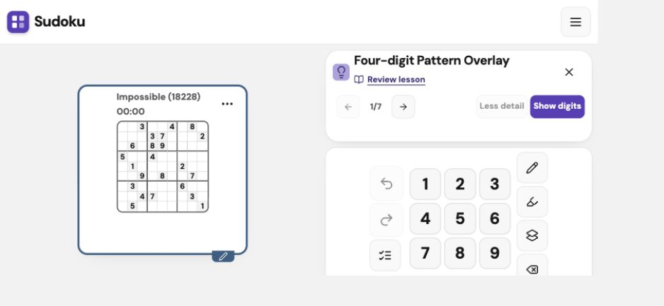
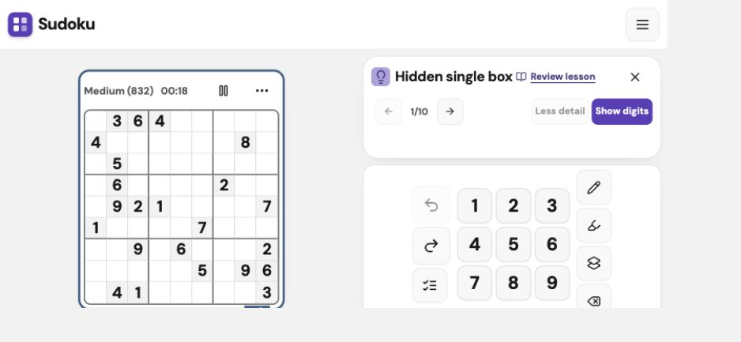
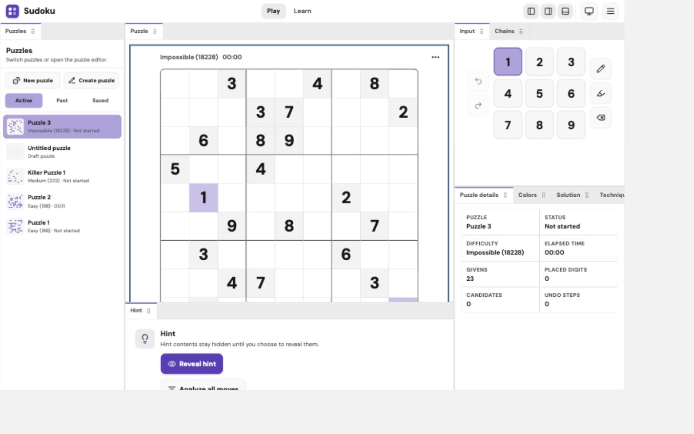
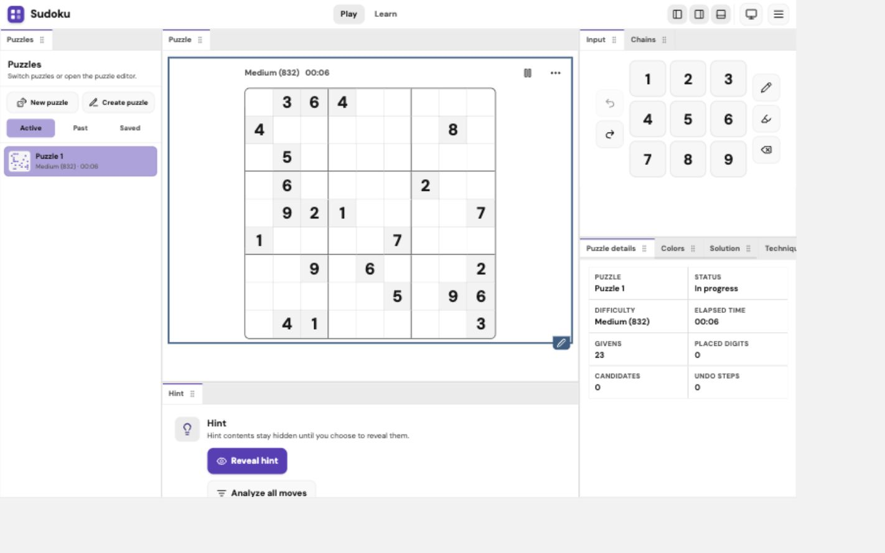

# Sudoku UAT — November 17, 2026

Target: https://coder13-sudoku.netlify.app/

Interactive browser testing covered normal and advanced play, repeated placements,
undo, invalid imports and manual puzzle saves, Classic and Killer generation,
Impossible generation and move analysis, hint reveals, lesson walkthroughs,
collections and empty filters, download limits, settings, completion, and statistics.
Responsive sizes below are measured CSS pixels: 320 × 568, 390 × 844,
844 × 390, 1280 × 800, and 1600 × 1000.

This was browser UAT with viewport emulation, not a concurrent traffic or physical
device test. The site offered an offline update at the start, which was applied;
another update notice appeared during testing. No exact deploy ID was captured.

## Issue tracker

| ID | Priority | Issue | Status |
| --- | --- | --- | --- |
| UAT-01 | P2 | Keyboard stops after mobile Technique finder changes to desktop | Fixed; verified locally |
| UAT-02 | P2 | A hint makes the landscape phone grid too small to use comfortably | Fixed; verified locally |
| UAT-03 | P2 | Closing Settings loses the originating page | Fixed; verified locally |
| UAT-04 | P2 | Advanced workspace requires scrolling to see all nine grid rows | Fixed; verified locally |
| UAT-05 | P3 | Statistics exposes an extra legacy difficulty | Fixed; verified locally |
| UAT-06 | P2 | Shortcut capture errors have no visible explanation | Fixed; browser and component checks passed |
| UAT-07 | P3 | New chain appears enabled when it cannot do anything | Fixed; browser and component checks passed |
| UAT-08 | P2 | Chain endpoints cannot be reached/activated by keyboard | Fixed; browser and component checks passed |
| UAT-09 | P2 | Hidden Settings radios uncheck the visible selected choice | Fixed; browser and component checks passed |
| UAT-10 | P2 | A failed initialization write hides readable saved puzzles | Fixed; behavioral regressions passed |
| UAT-11 | P2 | Variant JSON key order bypasses duplicate/replay identity | Fixed; compatibility regressions passed |
| UAT-12 | P2 | Shortcuts route is missing from the offline bundle | Fixed; production-artifact regression passed |

P2 indicates a functional or usability problem to address; P3 indicates a smaller
consistency issue. Findings below were observed on the deployed site. Local fix
validation is recorded separately so it is clear which version was tested.

## Fix branch and verification

Fixes are on `codex/uat-fixes`, based on `origin/main` commit `07eae53`, which
matches the deployed ten-level difficulty system and Windoku UI. The original
local `main` was 20 commits behind; it was left unchanged when the fix branch was
created. Three sub-agents implemented navigation/input, responsive layout, and
difficulty consistency changes.

The fixed app was tested at http://127.0.0.1:8767/. The existing matching browser
engine artifacts were reused from another worktree after confirming its engine
and build source were unchanged from the same commit. No Rust code changed.

- `npm run check`: passed.
- `npm test`: all 268 tests passed, including historical difficulty coverage.
- `git diff --check`: passed.
- Browser checks replayed the keyboard breakpoint failure, hint landscape sizing,
  Settings returns through subsections, filtered query preservation, direct Settings
  fallback, advanced grid sizing, and draft controls after scrolling.
- Physical-device testing, concurrent traffic, a fresh Rust build, and deployment
  were outside this fix verification.

## UAT-01 — Keyboard stops after a responsive layout change

1. Open an unfinished Classic puzzle at 390 × 844.
2. Open **Puzzle options → Technique finder**.
3. Resize to 1280 × 800 while the finder is open. The original reproduction used
   Advanced mode as the saved desktop preference.
4. Select an empty cell and type a digit.

**Observed:** the dialog disappears, but keyboard digits do nothing. Selecting
the cell and using the on-screen keypad still places a digit. Reloading restores
keyboard entry. Reproduced twice.

**Expected:** the finder should close cleanly or transition to its desktop panel,
and keyboard input should remain available once no dialog blocks play.

**Source evidence:** `Worktable.tsx` blocks keyboard handling whenever
`analysisOpen` is true, while the dialog renders only on mobile. The stale state
survives the breakpoint change.

**Fix:** keyboard, timer, and interaction guards now follow the actual visibility
of the mobile analysis dialog. Analysis state clears on desktop and puzzle changes.

**Local validation:** passed. Opened the finder at 390 × 844, changed to
1280 × 800, selected an empty cell, and placed a digit with the keyboard without
reloading. [Verification screenshot](keyboard-fixed.jpg).

## UAT-02 — Landscape hint reduces the grid to 130 pixels

1. Open a puzzle at 844 × 390.
2. Open **Actions → View hint**.
3. Compare the grid with the hint open and closed.

**Observed:** the grid shrinks from approximately 247 × 247 to 130 × 130.
Each cell is about 14 pixels across. The puzzle occupies the left column while
the hint and keypad occupy the right, leaving room for a larger grid.

**Expected:** opening a hint should preserve a readable, usable grid within its
landscape column.

**Fix:** the landscape grid-height rule now also overrides the more-specific
hint layout rule, since the secondary cards occupy the other column.

**Local validation:** passed. With a hint open at 844 × 390, the grid measured
approximately 247 × 247 instead of 130 × 130.

## UAT-03 — Closing Settings returns to Play

1. Open `/learn/xy-wing`.
2. Open the app menu and select **Settings**.
3. Optionally visit **Look & feel**.
4. Close Settings with **X**.

**Observed:** the app navigates to `/`, losing the lesson and its position.
Reproduced on mobile and desktop.

**Expected:** return to the page from which Settings was opened. A direct Settings
URL should have a sensible fallback.

[Settings opened from a lesson](settings-from-lesson.jpg) ·
[Play after closing Settings](settings-closes-to-play.jpg)

**Source evidence:** the Settings close callback in `Workspace.tsx` always
navigates to `/`.

**Fix:** Settings stores its originating URL and scroll coordinates before opening,
keeps them through subsection navigation, and restores them when closed.

**Local validation:** passed for the originating lesson URL after visiting
Look & feel, the exact filtered collection URL including query parameters, and
the Play fallback after directly loading Settings.
[Returned lesson screenshot](settings-return-fixed.jpg).

## UAT-04 — Advanced grid overflows its panel vertically

1. Use a 1280 × 800 viewport.
2. Enable **Advanced mode** with the Hint panel beneath the puzzle.
3. Inspect a normal puzzle before revealing detailed hint highlights.

**Observed:** the grid measures approximately 529 × 529 and extends to y=676,
while the puzzle dock ends at y=613. Bottom rows are hidden until the dock is
scrolled; scrolling hides the top rows. Creating a puzzle after scrolling can
also leave its Save/Cancel controls above the visible area.

**Expected:** the normal grid should fit the available dock height where practical,
so its nine rows can be seen together. Puzzle switches should not hide essential
creation controls through a retained scroll position.

**Source evidence:** the height-aware grid limit currently applies only while
`.hint-preview` is present.

**Fix:** ordinary and draft grids now use the dock's available height, as hint
previews already did. Puzzle changes explicitly reset the dock scroll position.

**Local validation:** passed. At 1280 × 800, the grid measured approximately
404 × 404 and fit fully inside the 532-pixel-high dock, with no vertical overflow.
At 1280 × 500, opening a draft after scrolling reset the dock to `scrollTop = 0`
and left Save/Cancel visible.

## UAT-05 — An extra difficulty appears in Statistics

1. Open **Puzzles → Statistics**.
2. Compare its difficulty rows with New puzzle and Learn's ten-level path.

**Observed:** Statistics adds an **Unfair** row even with zero such results.
New puzzle and Learn use Beginner, Easy, Medium, Tricky, Hard, Very Hard, Expert,
Master, Extreme, and Impossible.

**Expected:** current UI should present the same difficulty path. Old saved puzzles
should remain readable without adding an unused legacy row for everyone.

[Statistics evidence](statistics-unfair.jpg)

**Fix:** Statistics uses the ten current difficulty levels in their canonical
order. The historical Unfair row appears only when solved history contains it.
Saved puzzle compatibility remains intact.

**Local validation:** passed. The UI showed exactly the ten current difficulty
rows with no unused Unfair row. Focused regression coverage also checks that
historical Unfair results remain visible without duplicate rows.
[Statistics after the fix](statistics-fixed.jpg).

## Expanded pass and revised scope

The user later requested a broader pass, then narrowed the remaining scope to a
practical Firefox/Chrome smoke test. See [revised coverage](full-coverage.md),
[engine coverage](engine-coverage.md), [data/offline coverage](data-offline-coverage.md),
[interaction coverage](interaction-coverage.md), and [production build evidence](production-build.md).

After all additional fixes, `npm run check`, `git diff --check`, and the full
`npm test` suite passed: **295 tests, zero failures**. The [final test log](final-tests.log)
records that run. Native Mac Chrome and Firefox both passed the basic solving,
candidate, history, navigation, Settings-return, and hint flows.
The native-browser results are recorded in [browser cases](browser-cases.json).

## UAT-06 — Shortcut capture feedback is invisible

Click Change shortcut for Pencil mode, then press D (already assigned) or a
modified key. The old code left the binding at “Press a key” while placing the
explanation in an `sr-only` paragraph. The status is now visible. Browser checks
confirmed conflict, invalid-key, cancel, remap, reset, and saved default feedback;
all twelve editable bindings were remapped and reset.

[Visible feedback](shortcut-feedback-fixed.jpg) · component regression coverage in
`tests/interaction-components.test.ts`.

## UAT-07 — Empty New chain action looks available

An empty chain displayed an enabled New chain button, but the handler returned
without changing anything. The button now reflects that guard with a disabled
state until the active sketch has links. The browser accessibility state and
component checks confirmed the disabled state.

## UAT-08 — Chain drawing excludes keyboard users

Chain candidate buttons had `tabIndex=-1`, no shared arrow navigation, and ignored
keyboard-generated activation. They now use the existing roving candidate focus
and accept keyboard activation. Browser verification selected both endpoints with
Enter, created the displayed `1r1c3 − 2r1c3` link, and undid the link edit. Component
regressions cover tab stops, activation, and arrow/Home/End navigation.

## UAT-09 — Duplicate radio groups hide selected Settings choices

Settings mounts desktop and mobile copies and hides one with CSS. Fixed radio
group names allowed the hidden copy to uncheck the visible copy. On desktop
`/settings/input`, both visible candidate-layout radios were unchecked while the
hidden Grid radio was checked. Browser `check()` also failed to leave the visible
choice checked. The affected groups now receive independent `useId()` names.

The browser confirmed the saved Center and corner choice is visibly checked;
highlight style and workspace choices likewise each have one visible selection.
Component regressions exercise both copies together.

[Before](settings-radio-unchecked.jpg) · [After](settings-radio-fixed.jpg)

## UAT-10 — Readable saved puzzles disappear when a marker write fails

If local storage contains a readable library but lacks its initialization marker,
a failed marker write aborted hydration and left the UI library empty. Hydration
now retains readable puzzles and reports that storage is unavailable. A behavioral
regression failed before the fix and passed afterward. This failure path was tested
in the storage harness, not by altering a user's real browser storage permissions.

## UAT-11 — JSON field order changes a variant's identity

Importing an equivalent variant with reordered JSON object fields bypassed the
duplicate check and could create a second library/rating identity. Identity now
uses a stable object field order while preserving array/rule order and established
engine-generated identities. Import matching uses that shared identity.

Regressions cover every variant, genuinely different rules, legacy rating/seen
keys, and IndexedDB technique-history lookup/update compatibility. This was
verified by the behavioral harness; a separate browser duplicate replay was
deferred when the user reduced the scope.

## UAT-12 — Shortcuts cannot be reloaded from the offline shell

`/shortcuts` was absent from the prerender route list, so the production bundle
contained no precached `/shortcuts/index.html`. Added the route to the build.
An actual-artifact check failed on the old bundle (2/3 checks passed) and passed on
the fixed bundle (3/3). The fixed build has 153 prerendered pages and 175 cached
assets. A manual offline browser replay was deferred after the scope reduction.

## Checks that worked

- Conflicting placements received visual feedback and Undo restored the cell.
- Invalid import text and a manual puzzle with multiple solutions were rejected.
- Collection download counts of 0 and 999 showed an error and disabled Download.
- Empty collection filters explained the empty result and offered Clear filters.
- Classic Medium, Beginner, and Impossible generation and Killer generation completed.
- Staged hints, technique lessons, and practice walkthroughs opened successfully.
- A generated Beginner puzzle reached completion with solve details and action history.
- Settings text size was restored to 100%, and the workspace was restored to Standard mode.

Browser testing created local test puzzles, a draft, and one completed solve.
No changes were deployed as part of this UAT pass.
