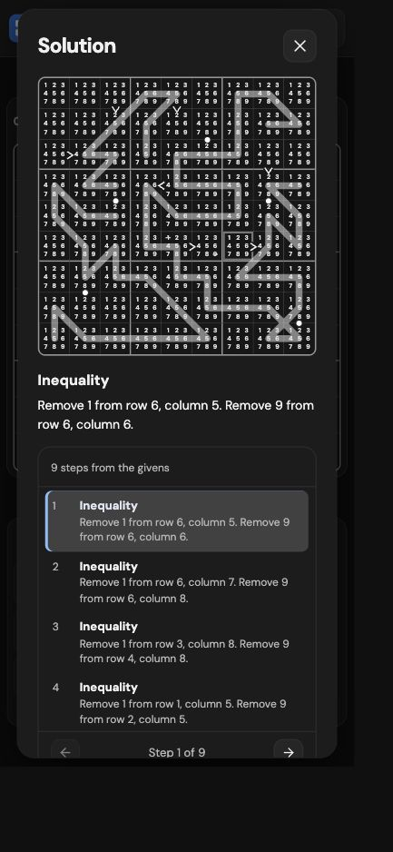
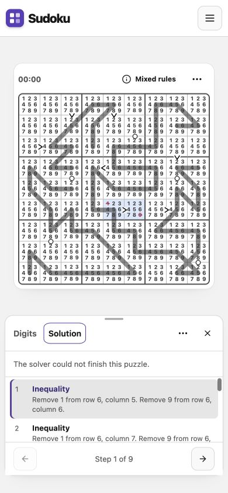
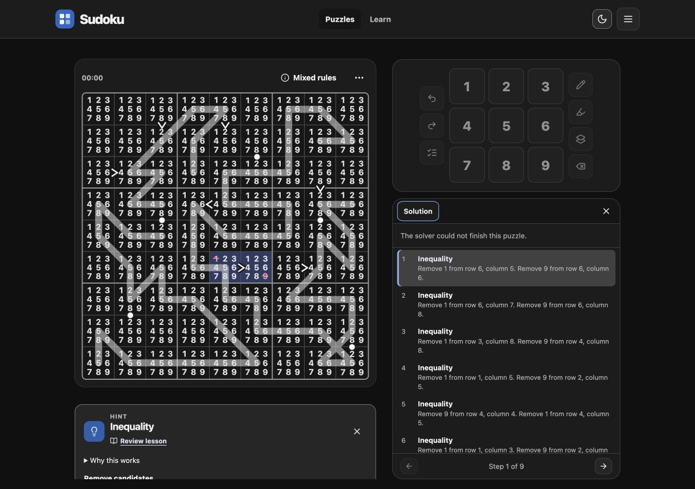

# Existing-variant browser review

Agent A uses the built-in browser for [issue 281](https://github.com/coder13/sudoku-app/issues/281). The browser connection now works. Screenshot approval remains pending.

## Source and scope

The control is CodeNameVerity's complete *Palindrome 14*, [Coach FzzD](https://sudoku.coach/en/s/FzzD). The preserved export is `palindrome-coach.json`, `examples[1]`. It retains three Palindromes, seven directed comparisons and five white dots. The review pastes that original code through the app's Import screen.

The baseline is PR 308's Netlify preview. The revised app runs locally from main `b9d5fe1` with this branch's presentation change. Main includes other released layout changes since PR 308. The screenshots compare the partial-result notice, not every layout difference.

The unchanged Rust/build sources match tested merge `94f1a991`. The local app uses the downloaded Cloudflare engine from that release. Its SHA-256 is `75b6fc3f0c3253319344a9e9daf9d9abbb30bd9848e53fa201033123d5ecc42d`.

## Observed behavior

- The import preview retains all three rule families and their accessible descriptions.
- Ordinary hints offer seven opening choices.
- The first applied hint removes 1 from R1C3 and 9 from R2C3. The displayed candidate domains match those removals.
- Undo restores both domains. Redo and reload retain the removals and complete rules.
- Finder reports twelve candidate targets after that hint. Selecting Inequality opens six proofs.
- The original human walkthrough stops after nine steps. It does not solve the grid.
- The revised mobile and desktop panels identify the incomplete result before the first step. The last position also states that the puzzle is not fully solved.

These observations cover this complete mixed source. They do not complete the review of every variant or rule arrangement.

## Screenshots for approval

These are actual viewport captures from the built-in browser. The revised views use effective CSS sizes of 390×844 and 1280×900. Full-page capture attempts are excluded because they changed the responsive layout during capture.

The baseline mobile dialog presents the nine-step path as “Solution”.

The revised mobile panel shows the incomplete-result notice before its steps.

The desktop panel shows the same notice in dark mode.

## Validation and remaining review

All 777 app tests pass. The 39 focused help/component tests pass. App types and the 179-component catalog pass. Five shared-component stories cover partial, empty, complete, loading and unavailable results.

The browser checks the first and last positions in the original nine-step path. Complete paths retain the “Final grid” state in component contracts. No native deduction, score or solution changes in this branch.

User approval and final PR checks remain open. Wider clue rendering, larger text, all other variants and combined-rule controls remain in the main review checklist.
