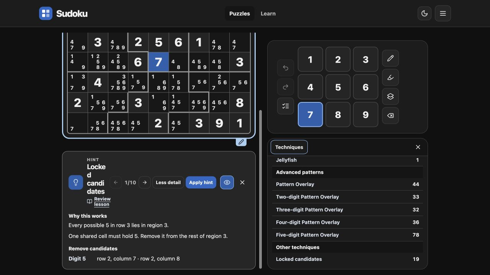
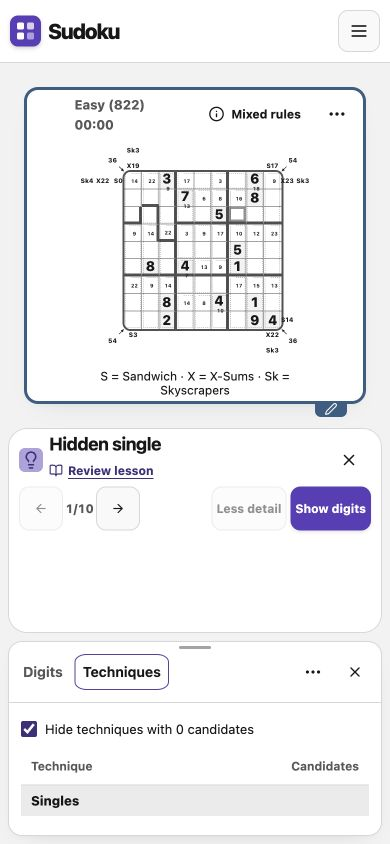
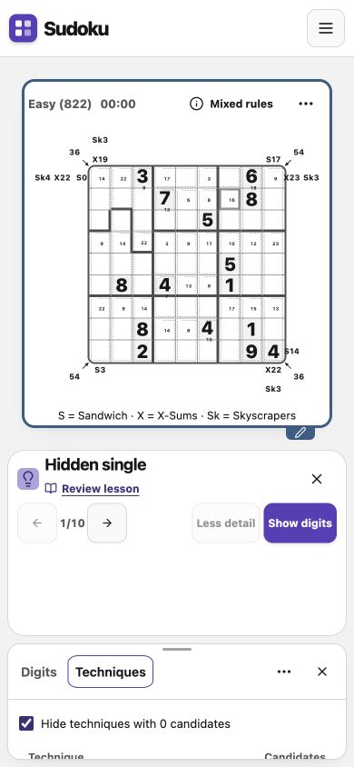

# Jigsaw and outside clues in Play

This built-in browser review covers two controls for [issue 281](https://github.com/coder13/sudoku-app/issues/281).

## Generated Jigsaw

A Medium game generated through New Puzzle offered ten opening hints. The 57-step walkthrough reached a filled final grid. Finder showed 19 Locked Candidates targets and ten proofs for that technique. The first proof used region 3 and removed 5 from R2C7 and R2C8. Applying the hint updated both cells and enabled Undo.

Advanced mode offered 116 hints after the removal. Advancing from hint 8 to hint 9 loaded the next page and displayed another Locked Candidates proof.

## Jigsaw with five companion rule families

The app imported the repository's [six-family fixture](../../../tests/fixtures/skyscrapers-jigsaw-mixed.json) through its puzzle-link input. The preview retained Jigsaw, Killer, Sandwich, Little Killer, X-Sums and Skyscrapers. The game offered ten opening hints. All 81 digits at the end of its 78-step walkthrough matched the fixture's verified completion.

At 390×844, opening a hint while Finder was active left 161 pixels for the playable grid. The fixed layout cap applied before the frame reserved space for all four gutters. The proposed layout uses the measured height for the frame and increases the grid to 219 pixels. The hint stays open and Finder scrolls within the input card. The page fits without scrolling horizontally or vertically.

At 351×760, the grid measured 190 pixels. The full hint placed 5 in R7C8 and Undo was available after switching to Digits. The current-main comparison used `980735a` and a fresh app Wasm build. The new Storybook interaction passed at 390×844. Types, the component catalog and 110 focused app and Wasm contracts passed. The screenshots are ready for approval.
